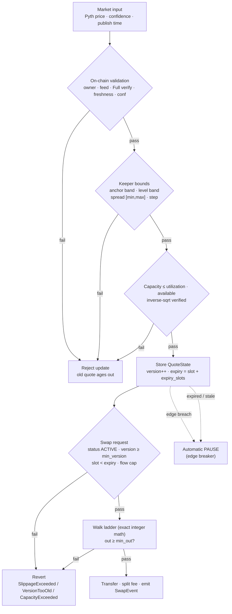
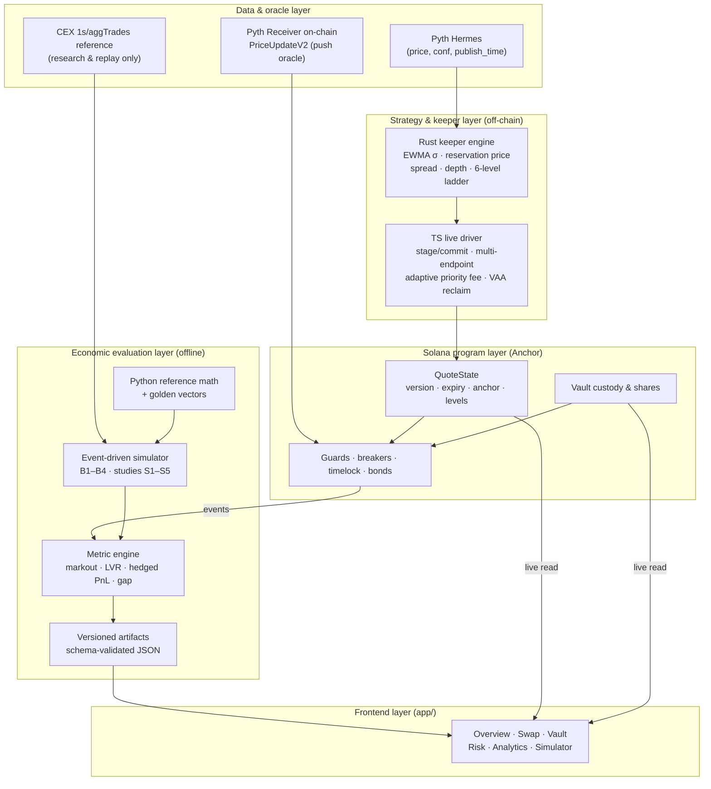
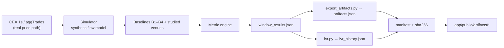

# ArbSwap

### Research-driven active liquidity management for Solana.

An on-chain, professionally managed market-making vault: **AMM-pooled capital + propAMM-style active quoting**, with a verifiable guarantee that *the price you are quoted is the price you get*.

[](#live-devnet-deployment)
[](#experiments-and-results)
[](#on-chain-program)
[](#frontend)
[](LICENSE)

ArbSwap pools LP capital into a two-token vault and continuously reprices a **six-level constant-product ladder** around a verified Pyth oracle. Inventory skew, volatility, oracle confidence and staleness move the **anchor and the depth**. Every quote is committed on-chain with a `version` and an `expiry_slot`; every swap either fills at least the quoted minimum or reverts. There is no spread captured between the quote and the fill.

> Formerly "TruQuote". Program id (Devnet): `2mwpYHpZ2TS6TjG3CbKBqQAwUv4hw7XrAbg4Kb6hyiNm`

**30-second summary.** Passive AMM LPs are systematically picked off by latency arbitrage (**LVR ∝ σ²·V**). ArbSwap is a pooled vault that behaves like a professional market maker: it re-prices with the market on-chain, prices its own inventory, throttles depth as volatility rises, and fails to a **stop** (expired quote) instead of to a **bad price**. Execution is exact integer math shared bit-for-bit by the program, the keeper, and an independent Python reference.

---

## Table of contents

1. [The problem: why passive liquidity is not enough](#the-problem-why-passive-liquidity-is-not-enough)
2. [Research foundations](#research-foundations)
3. [ArbSwap's solution](#arbswaps-solution)
4. [Vault mathematics](#vault-mathematics)
5. [LVR protection and active-liquidity logic](#lvr-protection-and-active-liquidity-logic)
6. [Circuit breakers and risk controls](#circuit-breakers-and-risk-controls)
7. [Complete system architecture](#complete-system-architecture)
8. [Vault lifecycle: LP deposit → withdrawal](#vault-lifecycle-lp-deposit--withdrawal)
9. [Project pipeline: market data → visible analytics](#project-pipeline-market-data--visible-analytics)
10. [Live Devnet deployment](#live-devnet-deployment)
11. [On-chain program](#on-chain-program)
12. [Keeper](#keeper)
13. [Frontend and demo experience](#frontend-and-demo-experience)
14. [Experiments and results](#experiments-and-results)
15. [Quick start](#quick-start)
16. [Security, network, and design boundaries](#security-network-and-design-boundaries)
17. [Roadmap and future research](#roadmap-and-future-research)
18. [Repository layout](#repository-layout)
19. [Documentation index](#documentation-index)

---

## The problem: why passive liquidity is not enough

### The LP problem

A constant-product AMM holds the invariant $x\cdot y = k$. Its price is a deterministic function of its own reserves, so **arbitrageurs — not the pool — set the price**. When the external market moves, anyone can trade against the stale curve and extract value from LPs *before* the curve catches up. Providing continuous liquidity is therefore a **short-volatility / short-gamma** position: LPs are paid fees for standing ready to be adversely selected.

Fees do not imply profit. Net LP economics is a sum of four distinct terms that are frequently conflated:

$$
\text{net LP PnL} \;=\; \underbrace{\text{fees}}_{\text{earned}} \;-\; \underbrace{\text{LVR}}_{\text{adverse selection}} \;+\; \underbrace{\Delta\text{inventory mtm}}_{\text{directional}} \;-\; \underbrace{\text{gas/ops}}_{\text{cost}}
$$

A numerical intuition: a pool holding \$1,000,000 at full depth, during a spike where realised per-second volatility doubles, bleeds on the order of $\sigma^2/8$ of its value per unit time to latency arbitrage. Doubling $\sigma$ **quadruples** the bleed. Fees are roughly linear in volume; LVR is quadratic in volatility — so in stress, passive liquidity loses on both axes at once.

### LVR, precisely

**Loss-Versus-Rebalancing** (Milionis, Moallemi, Roughgarden, Zhang, [arXiv:2208.06046](https://arxiv.org/abs/2208.06046)) measures the gap between an LP's mark-to-market and the PnL of an optimal rebalancing strategy that sells when price rises and buys when it falls. For a constant-product pool, in the continuous-price limit:

$$
\text{LVR} \;=\; \frac{\sigma^2}{8}\,V\,T, \qquad V = \text{active liquidity value}
$$

Economically: the LP's curve only moves **after** the arbitrageur has already moved its inventory. That unavoidable lag is the loss. It is **not** impermanent loss (an at-the-money round-trip metric), **not** fees, and **not** directional inventory PnL — it is the value transferred to faster traders.

### The design challenge

> How can a liquidity system (i) react to changing market conditions, (ii) manage its own inventory exposure, (iii) control risk when market data becomes unreliable, and (iv) make the resulting LP economics understandable and reproducible?

ArbSwap answers with an **oracle-anchored, inventory-aware, volatility-responsive vault** whose execution stays deterministic and on-chain-verifiable.

---

## Research foundations

ArbSwap is an engineering translation of market-microstructure and AMM research. Each row maps a result to a concrete design choice and the code that implements it. (Full source map: [`MATH.md` §16](MATH.md).)

| Research insight | Economic / mathematical intuition | ArbSwap design response | Implementation |
|---|---|---|---|
| **LVR** — Milionis et al., *Automated Market Making and Loss-Versus-Rebalancing* ([2208.06046](https://arxiv.org/abs/2208.06046)) | Constant-product LVR rate $=\sigma^2/8$ per unit value; loss scales with $\sigma^2 V$ | Volatility-scaled spread + depth throttle: shrink active depth $V$ as $\sigma$ rises; charge the spread floor | `vault/keeper/src/lib.rs` (depth rule), [`MATH.md` §6](MATH.md) |
| **Reservation price / inventory skew** — Avellaneda & Stoikov, *High-frequency trading in a limit order book* (2008) | The optimal quote midpoint moves with inventory to mean-revert exposure | Reservation price $P_{res}=P(1-gq)$, signed by normalized inventory $q$ | `vault/keeper/src/lib.rs::compute_quote`, [`MATH.md` §2](MATH.md) |
| **Dynamic fees** — Baggiani, Herdegen, Sanchez-Betancourt, *Optimal Dynamic Fees in AMMs* ([2506.02869](https://arxiv.org/abs/2506.02869)) | Fees should respond (≈linearly) to inventory and external price risk | Spread terms $a_1\sigma + a_2|q| + a_3(c/P)$ | [`MATH.md` §4](MATH.md), keeper |
| **Directional fees** — Alexander & Fritz, *Fees in Automated Market Makers* ([2406.12417](https://arxiv.org/abs/2406.12417)) | Widen the stale side under drift and toxic flow | Asymmetric `ask_extra`/`bid_extra` on the moving side | `vault/keeper/src/lib.rs`, [`docs/FORMULA.md` §5](docs/FORMULA.md) |
| **Concentrated liquidity** — Uniswap v3 whitepaper | A price range is a constant-product *segment* with liquidity $L$ | Six-level ladder of $\{\sqrt{lo},\sqrt{hi},L\}$ segments; exact segment walk | `vault/math/src/quote.rs::walk_ladder` |
| **Glosten–Milgrom (1985); ZeroSwap ([2310.09413](https://arxiv.org/abs/2310.09413))** | Adverse selection sets the break-even spread | Spread floor + confidence/staleness penalties; inventory resets on re-quote | [`docs/FORMULA.md` §4](docs/FORMULA.md) |
| **Active-liquidity measurement** — Solmaz, Heimbach, Milionis, *Active Liquidity On Chain* ([2609.38056](https://arxiv.org/abs/2609.38056)) | Markouts, quiet-flow half-spread, update-vs-swap cost | Metric engine: 2s markout, quiet half-spread, hedged PnL, quote-vs-fill gap | `simulation/analytics/metrics.py` |
| **Phantom liquidity / quote-vs-fill gap** — 0x, *PropAMM Shenanigans* | PropAMMs can quote better than they fill | Versioned quote + `min_out`/`min_version`; gap measured post-hoc | `vault/program/src/lib.rs::swap`, `docs/CLAIMS.md` |
| **Oracle risk** — Nadler, Schuler, Schar, *Blockchain price oracles* ([doi:10.1016/j.jcorpfin.2025.102908](https://doi.org/10.1016/j.jcorpfin.2025.102908)) | Stale/wide oracle data is a first-class risk | On-chain Pyth Full-verification, freshness (s), confidence cap | `vault/program/src/lib.rs::update_quote` |
| **Minimum-liquidity first deposit** — Uniswap v2; **pro-rata shares** — ERC-4626 | Prevent first-depositor share inflation; standard accounting | Burned `MIN_LIQUIDITY`; vault-favouring integer rounding | `vault/program/src/lib.rs::deposit` |

Coefficients (`a1..a5`, `e`, `g`, offsets/weights, `σ_target`, utilization) are **calibrated heuristics**, pre-registered and frozen on W1 (`simulation/data/results/frozen_params.json`); they are not claimed as theorem-proven optima.

---

## ArbSwap's solution

ArbSwap is a **vault that quotes like a market maker, transparently**.

- **Pooled capital, active quotes.** LPs deposit a base/quote pair; the vault mints pro-rata shares. A permissionless keeper prices a six-level ladder around the *verified* Pyth oracle.
- **Honest execution by construction.** The ladder is committed on-chain as `QuoteState` with `version` + `expiry_slot`. A swap passes `min_out` and `min_version`; the program walks the ladder with exact integer math and reverts (`SlippageExceeded`) rather than fill worse.
- **Bounded, never-trusted keepers.** The keeper moves prices only inside on-chain bands: anchor↔oracle deviation, per-level offsets, min/max spread, spread step, ladder capacity vs available reserves, update-slot age, and a per-window one-sided flow cap.
- **Fail to a stop, never to a bad price.** If the keeper stops, the quote expires and swaps revert (`QuoteExpired`). A permissionless, state-only circuit breaker can pause quoting; an automatic realized-edge breaker trips on keeper mis-anchoring.
- **Open + measurable.** Anyone can run a bonded keeper; the analytics pipeline publishes markouts, LVR benchmarks, hedged PnL and the quote-vs-fill gap.

### What is on-chain vs off-chain vs research

| Layer | Where | What lives there |
|---|---|---|
| **Enforced** | Solana program | custody, shares, quote bounds, Pyth verification, expiry, fees, breakers, timelock, bonds |
| **Decided** | Keeper (off-chain) | volatility EWMA, reservation price, spread, depth, ladder construction, priority fee |
| **Measured** | Simulation / analytics | markouts, LVR benchmark, hedged PnL, routed-world routing, adversarial bots |

### A market change, end to end

1. Pyth publishes a new SOL/USD price. The keeper reads it via Hermes.
2. The keeper updates its **EWMA volatility**, recomputes **inventory skew** $q$ and **reservation price** $P_{res}$, widens/narrows the **spread**, sizes **depth** against available reserves, and builds the six-level **ladder** with `arb-math`.
3. The keeper `stage_quote`s then `commit_quote`s it. The program **verifies the Pyth account** (owner, feed id, Full verification, freshness in seconds, price/conf equality), checks the anchor band, level band, spread bounds, slot monotonicity, and capacity vs reserves — then stores a new `QuoteState` and bumps `version`.
4. A trader's `swap` either fills **at least** `min_out` against that committed ladder, or reverts. The fee is `ceil(amount_in·fee_bps/10⁴)`.
5. The indexer/metric engine computes the markout of that fill; the keeper sees the new reserves on its next tick and re-quotes.

---

## Vault mathematics

Everything below is derived from the implementation; each formula links to its source. Notation: prices are **quote per base** (USDC/SOL); `bps = 1e-4`; all math is **Q64.64 fixed point** with no floats on-chain (`vault/math/src/{fixed,wide}.rs`).

| Symbol | Meaning |
|---|---|
| `B`, `Q` | base / quote reserves (atoms) |
| `S` | total shares outstanding |
| `P`, `P_res` | oracle price / inventory-adjusted reservation price |
| `q` | normalized inventory imbalance ∈ [−1, 1] |
| `s` | half-spread (fraction) |
| `L` | constant-product segment liquidity |
| `f_bps` | fee in basis points |

### A. Deposits

**Assets & decimals.** The vault is generic over a base/quote mint pair; the deployed demo is WSOL/USDC. The human oracle price is normalized **once** to raw atoms, `P_raw = P·10^(d_q − d_b)`, and that single value feeds inventory valuation, ladder bounds and the payload — no path applies the decimal scale twice (`docs/FORMULA.md` §2.3).

**First deposit** (enables price discovery and burns a locked minimum, Uniswap v2 style):

$$
\text{root} = \lfloor\sqrt{dB\cdot dQ}\rfloor,\qquad
\text{shares} = \text{root} - \text{MIN\_LIQUIDITY},\qquad
S = \text{root}
$$

**Subsequent deposits** must match the current composition; the vault mints the conservative side:

$$
\text{shares} = \min\!\left(\left\lfloor \frac{dB\cdot S}{B_{avail}}\right\rfloor,\ \left\lfloor \frac{dQ\cdot S}{Q_{avail}}\right\rfloor\right)
$$

where $B_{avail}, Q_{avail}$ exclude the tracked liability buckets. Only what the minted shares are worth is pulled (`F-10`). New deposits become withdraw-eligible only after the warm-up window.

**Single-sided entry** (`deposit_single`): the vault converts the unwanted leg against its **own committed ladder** and prices shares at the post-swap composition:

$$
\text{SellBase:}\quad
out = \text{walk\_ladder}(\text{ask}, s_{net}),\quad
B' = B_{net}+s_{net},\quad Q' = Q_{net}-out
$$
$$
dB = amount_{in}-s,\quad dq = out,\quad
\text{shares} = \min\!\left(\lfloor dB\cdot S/B'\rfloor,\ \lfloor dq\cdot S/Q'\rfloor\right)
$$

`s` is the integer root of $\lfloor dB\cdot S/B'\rfloor = \lfloor dq\cdot S/Q'\rfloor$, found by bounded bisection (≤64 steps). Only `amount_in` is pulled; the fee stays in the reserve.

> **Source:** `vault/program/src/lib.rs::deposit` / `::deposit_single`; rounding is vault-favouring everywhere.

### B. Share price and NAV

The vault does **not** compute a floating "share price"; it defines shares pro-rata over **available** reserves. The implemented NAV basis is:

$$
\text{NAV} = (B_{avail}\cdot P) + Q_{avail}, \qquad B_{avail}=B-(ins),\ Q_{avail}=Q-(kpr+proto)
$$

where `ins`, `kpr`, `proto` are the insurance / keeper / protocol **liability buckets**. Equivalently, share value is `NAV / S`. Dividends to LPs arrive as fees retained in the reserves; because the buckets are excluded from `avail`, fee liabilities never inflate LP claims. There is no separate LP fee bucket in `Config` (the LP share is the residual).

### C. Withdrawals and redemption

Withdrawals are **epoch-queued and pro-rata**:

```text
request_withdraw(shares)      → WithdrawTicket { shares, epoch }
crank_epoch()                 → close the epoch after epoch_slots (post-warmup)
claim_withdraw(ticket)        → out_B = floor(shares·B_avail/S)
                                out_Q = floor(shares·Q_avail/S)
```

- All payouts **round down** (vault-favouring); the epoch queue prevents fresh deposits front-running the accounting.
- Single-sided exit (`claim_withdraw_single`) pays one token by converting the unwanted leg against the ladder and enforces `payout ≥ min_out` (`SlippageExceeded`); if the ladder cannot absorb it, the instruction reverts with `CapacityExceeded` **leaving the ticket and shares intact** so the user can fall back to two-sided `claim_withdraw`.

> **Source:** `vault/program/src/lib.rs::request_withdraw`, `::crank_epoch`, `::claim_withdraw`, `::claim_withdraw_single`.

### D. Fees and accounting

$$
\text{fee} = \left\lceil \frac{amount_{in}\cdot f_{bps}}{10^4}\right\rceil,\qquad
\text{net}_{in} = amount_{in}-\text{fee}
$$

The fee is retained **in the reserve** and split by fixed bps shares into `insurance`, `keeper`, `protocol`; the residual accrues to LPs via available reserves. Fees are charged to the **trader** (via the input) and change only through a **timelocked** `set_params → apply_params` path.

```text
insurance = floor(fee·insurance_bps/10⁴)
keeper    = floor(fee·keeper_bps    /10⁴)
protocol  = floor(fee·protocol_bps  /10⁴)
LP_share  = fee − insurance − keeper − protocol
```

Fees do **not** increase NAV dollar-for-dollar in the accounting sense: the tokens stay in the reserve, and only the residual (after the liability buckets) is LP-claimable.

### E. Numerical walkthrough (illustrative)

Hypothetical numbers — *not* test output. `MIN_LIQUIDITY = 1000`.

| Step | Action | Reserves (B, Q) | Shares | Math |
|---|---|---|---|---|
| 1 | Alice first deposit 10 SOL, 2,000 USDC | (10, 2000) | `√(10·2000) − 1000 = 141−1000` → root 141 | root `=⌊√(dB·dQ)⌋`, shares `=root−M` |
| 2 | Price doubles; Bob deposits 10 SOL, 4,000 USDC | (20, 6000) | mint `min(⌊10·141/10⌋,⌊4000·141/2000⌋)=141` | proportional `min` |
| 3 | Withdrawal requested for 70 shares, then claimed | — | out_B `=⌊70·20/141⌋=9`, out_Q `=⌊70·6000/141⌋=2978` | pro-rata floors |

Every payout floors, so the vault can never be made insolvent by rounding. Full worked evidence lives in the test suite (`lifecycle_deposit_quote_swap_breaker_withdraw_preserves_value`).

### Implemented invariants

```text
out ≥ min_out, else revert (SlippageExceeded)
quote_version ≥ min_version, else revert (VersionTooOld)
expired quote never swaps
ladder input remainder == 0 on success
Σ base capacity  ≤ utilization_max · available_base
Σ quote capacity ≤ utilization_max · available_quote
min_spread_bps ≤ half_spread ≤ max_spread_bps
update_slot strictly increasing and ≤ clock.slot
checked arithmetic never wraps
```

---

## LVR protection and active-liquidity logic

Five independent layers bound LP loss. The first four are on-chain enforced; the throttle is a keeper policy bounded by on-chain caps.

### 1. Reservation price (inventory-aware)

$$
q = \frac{B\cdot P - Q}{B\cdot P + Q}\in[-1,1],
\qquad
P_{res} = P\,(1 - g\,q)
$$

When the vault is long base (`q>0`), `P_res` moves **down** so both quotes lean against accumulating more base — the vault prices its own inventory, it does not become a stale one-way counterparty.

### 2. Volatility estimation and jumps

Per-one-second returns with time normalization (clock-invariant; the same math runs in the keeper and on-chain in `observe_volatility`):

$$
r_t = \frac{|P_t - P_{t-1}|}{P_{t-1}},\qquad
n = \max(1,\operatorname{round}(\Delta t/1\text{s})),\qquad
v_t = \lambda^{n} v_{t-1} + (1-\lambda^{n})\,\frac{r_t^2}{n}
$$
$$
\sigma_t = \sqrt{v_t},\qquad
\text{jump} = \sigma_t>0 \ \wedge\ r_t > k_j\,\sigma_t
$$

Two EMAs are maintained (`λ_short ≈ 0.94`, `λ_medium ≈ 0.99`), with `k_j = 4`. Spec: [`docs/VOLATILITY_MATH_SPEC.md`](docs/VOLATILITY_MATH_SPEC.md); code: `vault/math/src/volatility.rs`, `vault/program/src/lib.rs::observe_volatility`.

### 3. Risk-sensitive spread

$$
s_{raw} = s_{floor} + a_1\sigma + a_2|q| + a_3\frac{c}{P} + a_4\max(0,\text{age}-grace) + a_5\,\text{jump}
$$
$$
s = \operatorname{clamp}(s_{raw},\ s_{min},\ s_{max})
$$

The on-chain floor is `min_spread_bps` (default **2 bps**), the ceiling `max_spread_bps`, and—since S2-37—an optional per-update `max_spread_step_bps` bounds how fast the book may move. A directional add-on widens the *stale* side under drift:

$$
\text{ask\_extra} = e\max(0, \text{move}),\qquad
\text{bid\_extra} = e\max(0, -\text{move}),\qquad
\text{move} = \frac{P_t - P_{t-W}}{P_{t-W}}
$$

### 4. LVR depth throttle — shrink `V` when σ rises

Because LVR $=\sigma^2 V/8$, the vault reduces **active depth** as risk rises:

```text
σ-factor          = min(1, σ_target / σ)
confidence-factor = max(0, 1 − c / c_max)
jump-factor       = 1 − jump_cooldown      (if jump else 0)
depth_rule        = σ-factor · confidence-factor · (1 − jump-factor)
depth_mult        = min(depth_rule, depth_budget)
```

The theoretical budget $V_{active} \le 8(R-g_{gas})/\sigma^2$ is the derivation; the **enforced** rule on-chain is the σ/confidence/jump throttle plus the utilization cap (below). At $\sigma\to 0$ the mathematical budget is unbounded, but the utilization cap still limits displayed depth.

### 5. Capacity bound, oracle freshness, and expiry

- **Capacity vs reserves.** `update_quote` requires, for the quoted ladder,
  $\sum_k C^{base}_k \cdot 10^4 \le u_{max}\cdot B_{avail}$ and the mirror for quote; `utilization_max_bps` is capped at **8,000 (0.8)**. Inverse-square-root estimates are verified conservatively so an over-deep ladder can never be accepted (`InvalidInverseSqrt`).
- **Oracle.** At commit, the program verifies the Pyth `PriceUpdateV2` (owner, feed id, `VerificationLevel::Full`, freshness in **seconds**, price + confidence equality) and bounds the anchor step.
- **Expiry.** `expiry_slot = slot + expiry_slots` (Devnet demo: 120 slots). An expired quote simply cannot swap.

### The LVR benchmark and published results

The repository computes the **passive baseline** from the Milionis et al. identity and publishes it as a public, versioned artifact (`app/public/analytics/lvr_history.json`, generated by `simulation/analytics/lvr.py`):

$$
\text{PassiveLVR} = \frac{\sigma^2}{8}\,V\,T
$$

| Public LVR artifact (modeled weekly replay) | Value |
|---|---|
| Aggregate modeled volume | \$45,707,543 |
| Modeled gross vault fees | \$4,570.75 |
| Passive-baseline LVR benchmark | \$1,003.46 |
| Modeled E1 — hedged-PnL improvement vs passive baseline | +1008% (denominator-sensitive) |
| ArbSwap realized LVR | *not separately measured* (reported `null`, never fabricated) |

The **2-second markout** is the project's execution-quality metric and is never relabeled "LVR". Interpretation and limits: [`docs/PUBLIC_LVR_TRANSPARENCY_PLAN.md`](docs/PUBLIC_LVR_TRANSPARENCY_PLAN.md), [`docs/CLAIMS.md`](docs/CLAIMS.md) #22.

---

## Circuit breakers and risk controls

Safety is a first-class part of the design, not a bolt-on.

| Control | Trigger / condition | System response | Why it matters | Verification |
|---|---|---|---|---|
| **Stale-oracle rejection** | `now − publish_time > max_staleness_seconds` (2 s) | Reject `update_quote`; old quote ages out | No quoting on stale prices | `rejected_wide_confidence_leaves_the_old_quote_to_expire` |
| **Confidence cap** | `c/P > max_conf_bps` (10 bps) | Reject update (fails closed) | Wide oracle ⇒ uncertain price | `rejected_wide_confidence_*` |
| **Anchor band** | `|anchor − oracle| > max_anchor_step` | Reject update (`AnchorTooFarFromOracle`) | Keeper cannot jump the book | `anchor_far_from_the_oracle_is_rejected` |
| **Level band** | any level outside `MAX_LEVEL_OFFSET_BPS` (500) | Reject update | No phantom far-out quotes | `level_far_from_the_anchor_is_rejected` |
| **Spread bounds** | `half_spread ∉ [min,max]` or step too large | Reject update | Enforces the risk premium; no zero-spread picks | `a_zero_spread_quote_is_rejected` |
| **Capacity vs reserves** | `Σ capacity > utilization·available` | Reject update (`UtilizationExceeded`) | No phantom depth / failed payouts | `a_ladder_deeper_than_the_reserves_is_rejected` |
| **Slot monotonicity** | `update_slot` not newer / too old | Reject update (`UpdateSlotTooOld`) | No replay, no stale overwrite | `an_old_update_slot_is_rejected` |
| **Window flow cap** | one-sided flow beyond window | Reject swap (`FlowCapExceeded`) | Bounds directional inventory push | `window_flow_cap_stops_one_sided_flow` |
| **Expiry breaker** | stored quote expired/stale, `version>0` | `trip_breaker` → PAUSED, permissionless | Keeper-down ⇒ market stops filling | `trip_breaker_on_expiry`, `keeper_outage_lets_the_quote_expire` |
| **Realized-edge breaker** | cumulative edge ≤ `−max_edge_loss_bps·available` | Automatic PAUSE | Catches keeper mis-anchoring | `malicious_keeper_edge_loss_trips_within_the_window` |
| **Volatility kill-switch** | `σ > max_sigma` / stale obs / wide conf | Reject quotes; depth → 0 | Stop quoting into a spike | `volatility_guard_enforces_spread_floor_and_depth_cap` |
| **Swap guards** | `version < min_version`, expired, `out < min_out`, input > capacity | Revert (whole tx) | Honest execution; no bad fill | `swap_enforces_slippage_version_and_size` |
| **Wind-down** | admin | Pause new risk, allow exits | Graceful shutdown | `wind_down` tests |

**Failure path**



Recovery: the breaker is **state-only**; `reset_breaker` is admin-only. An expired quote recovers automatically on the keeper's next successful `commit_quote`.

---

## Complete system architecture



| Component | Path | Responsibility |
|---|---|---|
| On-chain program | `vault/program/src/lib.rs` | custody, shares, quote state, swap, guards, breakers, timelock, keeper bonds |
| Shared integer math | `vault/math/src/` | fixed-point ladder walk, capacities, fees, share math (no Solana deps) |
| Keeper core | `vault/keeper/src/` | Pyth/Hermes parse, quote computation, payload encoder, offline pre-validation |
| Keeper driver | `scripts/devnet/keeper_live.ts` | live staged-quote pipeline, multi-endpoint broadcast, VAA-rent reclamation |
| Aggregator adapter | `vault/aggregator/src/` | Jupiter-style `out_given_in` / `in_given_out` / `best_price` |
| Reference math | `simulation/reference/` | high-precision Python reference + golden-vector generator |
| Simulator | `simulation/sim/` | event-driven replay, baselines B1–B4, studies S1–S5 |
| Analytics | `simulation/analytics/` | indexer, metric engine, static dashboard |
| Attackers | `simulation/attackers/` | E7 adversarial bots + on-chain account attacks |
| Frontend | `app/` | Vite + React 19 dApp (live on-chain state + published artifacts) |

**Interfaces.** Keeper→program: `stage_quote`/`commit_quote` with an in-band Pyth account (single shared blockhash, atomic push+commit). Program→analytics: Anchor events. Analytics→frontend: versioned JSON artifacts under `app/public/artifacts/` and `app/public/analytics/`.

---

## Vault lifecycle: LP deposit → withdrawal

```mermaid
sequenceDiagram
  autonumber
  actor LP
  participant FE as Frontend (app/)
  participant Pyth as Pyth (Hermes + on-chain)
  participant K as Keeper
  participant PR as Solana program
  LP->>FE: Connect wallet (Phantom/Solflare, Devnet)
  LP->>FE: Enter base+quote, preview deposit
  FE->>PR: deposit(base, quote, min_shares)
  PR->>PR: verified genesis + vault ACTIVE
  PR->>PR: first deposit √(dB·dQ)−MIN_LIQ ; else min(floor(dB·S/B),…)
  PR-->>LP: DepositTicket (shares activate after warm-up)
  Note over PR: shares pro-rata over available (fee-net) reserves
  loop every keeper tick
    Pyth-->>K: price · confidence · publish_time
    K->>PR: stage_quote → commit_quote (atomic Pyth push)
    PR->>PR: verify Pyth · bounds · capacity → QuoteState.version++
  end
  LP->>FE: Request withdraw(shares)
  FE->>PR: request_withdraw(shares) → WithdrawTicket{epoch}
  PR->>PR: crank_epoch (after epoch_slots)
  LP->>FE: Claim
  FE->>PR: claim_withdraw(ticket) → out_B=⌊shares·B_avail/S⌋, out_Q=⌊shares·Q_avail/S⌋
  PR-->>LP: base + quote (vault-favouring rounding)
```

Under the hood: reserves live in program-controlled PDAs address-bound to the vault; every instruction validates account bindings; withdrawals are MEV-resistant by construction (epoch queue + pro-rata floors). Single-sided entry/exit (`deposit_single` / `claim_withdraw_single`) is behind `VITE_ENABLE_SINGLE_SIDED` (default **off**) and reverts rather than partially filling when the ladder cannot absorb the leg.

---

## Project pipeline: market data → visible analytics

Two clearly separated paths.

### Live path (on-chain)


### Research path (offline, deterministic)



- **Input provenance.** Prices are real (Binance SOL 1s / aggTrades); **flow is synthetic** (noise + informed), so modelled metrics are model outputs over a real price path — the method is stated per metric.
- **Parameter config.** W1 calibrates the flow model and passive pool only; ArbSwap params are frozen (`frozen_params.json`).
- **Artifacts & integrity.** `scripts/export_artifacts.py` regenerates from the bundle; `scripts/check_bundle_freshness.py` + `manifest.json` pin SHA-256; schemas under `simulation/data/schema/`.
- **Reproduce:** `python -m simulation.sim.study calibrate|evaluate|studies|render`, `python -m simulation.sim.router`, `python -m simulation.analytics.lvr`.

**Where does data come from, how is it computed, how does the UI get it?** Real CEX price path → deterministic replay + metric engine → schema-validated JSON artifacts → shipped in `app/public/` and fetched by the Analytics page. The **live** vault state on Overview/Swap/Vault/Risk is read directly from Devnet RPC, never from the artifacts.

---

## Live Devnet deployment

A fully wired WSOL/USDC vault is deployed and running on Devnet.

| Item | Address |
|---|---|
| Program | `2mwpYHpZ2TS6TjG3CbKBqQAwUv4hw7XrAbg4Kb6hyiNm` |
| Vault (PDA) | `8yvFBv9gxiTWRF2vAa6Z5i1DGzpYgNETSP6z8yp82XPt` |
| Config (PDA) | `ErVDFAHWSK5SjKqvaNJoqv91r4vNH7VmqteURqdEo2aT` |
| QuoteState (PDA) | `5MsGbdHv3ouXrHT9f7JVQ6b7eVETTiVCzYSGw5DTYAgG` |
| WSOL reserve | `8vfr2KmMmXYUTjRg5cAiSYD6EhN1d8pjJnmFC95E2vfm` |
| USDC reserve | `G8q1WMKT8fnGQh85kCB8Aihf6F7tctXJDKbA6gn1jPeS` |
| WSOL mint | `So11111111111111111111111111111111111111112` |
| Circle Devnet USDC mint | `4zMMC9srt5Ri5X14GAgXhaHii3GnPAEERYPJgZJDncDU` |
| Pyth SOL/USD feed id | `ef0d8b6fda2ceba41da15d4095d1da392a0d2f8ed0c6c7bc0f4cfac8c280b56d` |

Deployed parameters (read live from `Config`): `expiry_slots = 120`, `max_staleness_seconds = 2`, `max_conf_bps = 10`, `fee_bps = 1`, `min_spread_bps = 2`, `max_update_slot_age = 25`, `utilization_max_bps = 5000`.

---

## On-chain program

A single Anchor program. Ladder size 6; admin timelock 216,000 slots.

<details>
<summary><b>State accounts (PDA seeds)</b></summary>

| Account | Seeds | Purpose |
|---|---|---|
| `ProgramConfig` | `[b"program"]` | deploy admin |
| `Vault` | `[b"vault", base_mint, quote_mint]` | mints, reserves, share mint/lock, total shares, fee buckets, epoch, status |
| `Config` | `[b"config", vault]` | keeper, treasury, Pyth feed id, fee split, safety bounds, min bond |
| `QuoteState` | `[b"quote", vault]` | version, update/expiry slot, anchor/reservation, spread, ask/bid levels, oracle price/conf/publish, flow window, edge tracker, author |
| `PendingQuote` | `[b"pending_quote", vault, keeper]` | staged update, nonce, stage slot, state snapshot |
| `PendingConfig` | `[b"pending", vault]` | timelocked parameter change |
| `PendingClaim` | `[b"claim", vault]` | timelocked fee claim |
| `DepositTicket` | `[b"dep", vault, user]` | shares, activate slot |
| `WithdrawTicket` | `[b"wd", vault, user]` | shares, epoch |
| `KeeperBond` | `[b"keeper", vault, keeper]` | bond, slashed, unbond cooldown |
| `KeeperReward` | `[b"reward", vault, keeper]` | per-keeper base/quote accrual |
| `VolatilityState` | `[b"vol", vault]` | EWMA short/medium, jump state, sigma params |
| `PendingVolatilityParams` | `[b"vol_pending", vault]` | timelocked volatility params |

</details>

**Instructions.** `initialize_program`, `initialize_vault`, `initialize_volatility`; LP: `deposit`, `deposit_single`, `request_withdraw`, `crank_epoch`, `claim_withdraw`, `claim_withdraw_single`; quotes: `update_quote`, `stage_quote`, `commit_quote`, `migrate_quote_state`; `swap`; risk: `trip_breaker`, `reset_breaker`, `wind_down`; admin/timelock: `set_params`, `apply_params`, `propose_admin`, `accept_admin`, `cancel_admin`, `propose_fee_claim`, `execute_fee_claim`; bonds/rewards: `bond_keeper`, `unbond_keeper`, `slash_keeper`, `claim_keeper_reward`; volatility: `propose_volatility_params`, `apply_volatility_params`, `observe_volatility`.

**Selected errors.** `InvalidOracle` (6015), `AnchorTooFarFromOracle` (6020), `FlowCapExceeded` (6021), `UtilizationExceeded` (6022), `QuoteExpired` (6030), `VersionTooOld` (6031), `SlippageExceeded` (6032), `CapacityExceeded` (6033), `UpdateSlotTooOld` (6037), `StalePendingQuote` (6039), `StagedStateChanged` (6040), `UnattributedQuote` (6042).

---

## Keeper

A Rust quote engine plus a TypeScript live driver.

- **Volatility estimator** — time-normalised EWMA (`λⁿ` decay, `r²/n` innovation) shared with the program, plus jump detection.
- **Adaptive priority fee** — scales with σ, doubles on a jump, clipped to a floor/cap.
- **Reliability** — bounded timeouts (12 s) and a per-endpoint token-bucket budget; first-landed multi-endpoint broadcast of identical signed bytes (duplicates collapse to one signature); **ambiguous outcomes are inspected, never blindly resubmitted** (`UNOBSERVED` → `getSignatureStatuses` → back off); success is only *confirmed + `version` strictly advanced + quote still live*; a catch-all keeps it alive across transient RPC/Pyth-SDK errors.
- **VAA-rent reclamation** — every Pyth push creates a Wormhole `EncodedVaa` (~0.00236728 SOL rent). Orphans are reclaimed via the Pyth SDK (`findOwnedEncodedVaaAccounts` → `closeEncodedVaa`) with a grace window exceeding max tx lifetime, plus batching.
- **Offline pre-validation** — the keeper mirrors every `Config` bound so no transaction is spent on a knowable rejection.

---

## Frontend and demo experience

Vite + React 19 + TypeScript, wallet-adapter (Phantom / Solflare), Anchor + web3.js. Six routes, all driven by live on-chain state or the published artifact bundle — no mock data.

| Page | Source of truth |
|---|---|
| **Overview** | live `ProtocolContext` (TVL, vault, quote, params, risk) + model metrics |
| **Swap** | live `QuoteState` ladder + reserves; wallet balances; integer ladder math |
| **Vault** | live vault/shares/tickets; deposit/withdraw/claim builders (single-sided behind `VITE_ENABLE_SINGLE_SIDED`) |
| **Risk** | live breaker/params + on-chain `VolatilityState` read |
| **Analytics** | published `/artifacts/*.json` + optional indexed on-chain export |
| **Simulator** | deterministic offline streams (no network/wallet/tx) |

**Judge walkthrough.** (1) Open **Overview** — live TVL, quote status, params. (2) **Swap** — watch the depth ladder and the quote freshness flip to *Expired* then back to *Live*; the swap flow is `build → simulate → preview → confirm → sign → wait confirmed`, re-reading a fresh quote at submit time (a stale quote discards the prepared transaction). (3) **Vault** — deposit/withdraw lifecycle. (4) **Risk** — circuit-breaker state and the on-chain volatility regime. (5) **Analytics** — modeled markouts, LVR benchmark and routed-world comparison.

Demo media: [`docs/demo_backup.mp4`](docs/demo_backup.mp4), [`docs/pitch_deck.pdf`](docs/pitch_deck.pdf), [`docs/headline_chart.svg`](docs/headline_chart.svg).

---

## Experiments and results

The research pipeline is the evidence layer. Prices are real; the flow model is synthetic, so the following are **model outputs over a real price path** — the project's experimental claims, each traceable to an artifact.

### Economic results (held-out windows W2–W6, `artifacts.json`)

| Window | Regime | ArbSwap 2s markout | B1 passive markout | ArbSwap hedged PnL | B2 fixed-spread hedged PnL | E1 vs baseline |
|---|---|---|---|---|---|---|
| W2 | unlabelled | **+5.61 bps** | +0.24 bps | **+4,895** | −10,342 | +687% |
| W3 | crash | **+4.66 bps** | +0.32 bps | **+4,357** | −8,561 | +470% |
| W4 | trend | **+4.00 bps** | +0.18 bps | **+3,961** | −12,034 | +726% |
| W5 | unlabelled | **+6.03 bps** | +0.03 bps | **+4,860** | −4,023 | +2,407% |
| W6 | calm | **+6.81 bps** | +0.18 bps | **+4,960** | −2,004 | +750% |

ArbSwap turns **positive 2s markout** in every held-out window while the passive/fixed-spread baselines do not; **E1** is the modeled hedged-PnL improvement vs the passive baseline (denominator-sensitive). Reproduce: `python -m simulation.sim.study evaluate`.

### Routed world (ArbSwap vs a passive pool vs a propAMM-like venue)

| Venue | Volume share | Fill share | 2s markout |
|---|---|---|---|
| ArbSwap | 0.03% | 1.6% | **+1.99 bps** |
| B1 passive | 0.33% | 16.9% | −5.13 bps |
| PropAMM-like (~0.5 bps) | **99.6%** | 81.5% | −1.19 bps |

In the **no-propAMM niche** (long-tail pairs) ArbSwap takes **27.9%** routed volume with better markout than the passive baseline. The honest reading: ArbSwap is not a low-spread latency winner; it is a *risk-managed, honest* venue that dominates passive liquidity on markout. Source: `python -m simulation.sim.router`.

### Public LVR artifact (modeled)

| Metric | Value |
|---|---|
| Aggregate modeled volume | \$45,707,543 |
| Modeled gross fees | \$4,570.75 |
| Passive-baseline LVR benchmark | \$1,003.46 |
| Modeled E1 (hedged-PnL improvement) | +1008% |
| ArbSwap realized LVR | `null` (not separately measured) |

### Software correctness (separate from the economic thesis)

| Suite | Count | Source of truth |
|---|---|---|
| Rust (`cargo test --workspace`) | **290** | `artifacts.json::test_counts` |
| Python (`pytest simulation -q`) | **266** | `artifacts.json::test_counts` |
| Frontend (`vitest run`) | **208** | `app/` |
| Golden vectors (Rust ↔ Python, bit-exact) | **997** | `vault/math/tests/golden_vectors.txt` |
| Single-sided golden vectors (Python ↔ Rust + UI) | **600** | `vault/program/tests/single_sided_vectors.txt` |
| Guard-mutation coverage | **58 / 58** caught | `artifacts.json::mutation` |

### Measured compute units

Canonical source: `artifacts/public/cu.json` (single source of truth).

| Instruction | CU | | Instruction | CU |
|---|---|---|---|---|
| `swap` | 63,579 | | `claim_withdraw` | 23,730 |
| `update_quote` | 47,836 | | `request_withdraw` | 18,160 |
| `deposit` | 43,657 | | `slash_keeper` | 16,901 |
| `bond_keeper` | 26,130 | | `claim_keeper_reward` | 14,267 |
| `accept_admin` | 9,365 | | `crank_epoch` | 5,164 |

Reproduce all of the above with the commands in [Quick start](#quick-start). Detailed write-ups: [`docs/RESULTS.md`](docs/RESULTS.md), [`docs/P1_RESULTS.md`](docs/P1_RESULTS.md), [`docs/HEADLINE.md`](docs/HEADLINE.md), [`docs/CLAIMS.md`](docs/CLAIMS.md).

---

## Quick start

### Prerequisites

- Rust + `cargo`, Solana/Anchor toolchain, Node 20/22, Python ≥ 3.11.

### Build and test everything

```bash
# Rust: math + keeper + aggregator + program
cargo fmt --all -- --check
cargo clippy -p arb-math -p arbswap-keeper -p arb-aggregator -p arbswap -- -D warnings
cargo test --workspace

# Python reference + simulator + analytics + attackers
python -m venv .venv && . .venv/bin/activate && pip install -r requirements.txt
pytest simulation -q

# Frontend
cd app && npm install && npm run lint && npm test && npm run build
```

### Run the simulator / regenerate artifacts (offline, no keys)

```bash
python -m simulation.sim.study calibrate && python -m simulation.sim.study evaluate
python -m simulation.sim.study studies && python -m simulation.sim.study render
python -m simulation.sim.router          # routed-world table
python -m simulation.analytics.lvr       # public LVR artifact
python scripts/export_artifacts.py       # rebuild artifacts.json + manifest
```

### Frontend (reads the live Devnet vault — read-only until you connect a wallet)

```bash
cd app
npm install
npm run dev        # http://localhost:5173
```

Connect Phantom or Solflare on **Devnet**. Overview/Swap/Vault/Risk/Analytics render live on-chain state; the Simulator runs offline.

### Keeper (keeps the book fresh — signs `stage_quote`/`commit_quote`; no swaps)

```bash
cd scripts/devnet
set -a; . ../../.env; set +a          # PYTH_API_KEY / RPC / keypair path (never commit)
export ARBSWAP_RPC_FALLBACKS=https://api.devnet.solana.com
../devnet/demo_up.sh 3600             # supervised, single-instance (flock)
```

> **Commands that change state:** everything under `scripts/devnet/` that submits (deploy, keeper live driver, smoke tests) signs Devnet transactions. Everything else (tests, simulation, lint, `export_artifacts`) is local and read-only. Use **test funds only**; no secrets belong in `VITE_*` or the repo.

### Docs/bundle/secret gates

```bash
python scripts/check_docs_consistency.py
python scripts/check_bundle_freshness.py
python scripts/banned_words.py
python scripts/secrets_scan.py
```

---

## Security, network, and design boundaries

- **On-chain guards are the boundary.** Keepers, LPs, traders, aggregators, RPC nodes and other programs are untrusted; the program validates every account binding and every bound per instruction.
- **Fails to a stop.** Stale oracle, expired quote, tripped breaker, or unbound account ⇒ revert or pause — never a degraded fill.
- **Least privilege.** Admin has only timelocked actions and a pause/wind-down switch and **cannot seize LP reserves**; fee claims are timelocked and pay a fixed treasury.
- **Reproducible evidence.** Guards are exercised by the LiteSVM lifecycle, oracle-scaling, breaker, recovery and security suites; a **58-guard mutation table** maps every guard to a mutation the tests catch.
- **Network:** Devnet only. The deployed program enforces the strict 2-second Pyth freshness rule at commit; the demo quote window is 120 slots. **No independent external audit yet** — a prerequisite before any use with real funds.

---

## Roadmap and future research

- **Real-flow / adverse-selection evaluation** — extend the aggTrades study beyond the current high-volatility days; measure the quote-vs-fill gap with funded mainnet trades.
- **Economic calibration** — walk-forward calibration of `a1..a5`, `e`, `g`, offsets/weights and `σ_target`, reporting losing regimes.
- **Broader scenario testing** — more volatility regimes, oracle-latency sweeps, and multi-pair vaults.
- **Risk-control verification** — formalize the on-chain edge/oracle-lag loss accounting (the edge breaker detects mis-anchoring, not oracle lag).
- **Compute** — reduce `update_quote`/`swap` CU.
- **Independent review** — external audit of the program before mainnet.
- **Aggregation** — RFQ/batch + Jupiter routing integration via the existing adapter.

---

## Repository layout

```
vault/
  program/        Anchor program (guards, custody, swap engine, breakers, timelock)
  math/           Pure fixed-point math shared bit-exactly by program, keeper, aggregator
  keeper/         Rust keeper: oracle tick -> arb-math -> staged quote payload
  aggregator/     Jupiter-style quote/swap adapter
  e2e/            End-to-end harness
simulation/
  reference/      High-precision Python reference + golden-vector generator
  sim/            Event-driven simulator, baselines, studies
  analytics/      Indexer + metric engine + static dashboard
  attackers/      Adversarial bots (E7)
  data/           Download scripts only (raw data gitignored)
app/              Vite + React dApp (Overview / Swap / Vault / Risk / Analytics / Simulator)
scripts/          Devnet scripts (keeper, deploy, measurement) + doc/bundle/secret gates
docs/             Spec, architecture, formula, security, claims, results, math explainer
tests/            Integration tests + golden vectors
```

---

## Documentation index

- [`docs/VAULT_MATH_EXPLAINED.md`](docs/VAULT_MATH_EXPLAINED.md) — vault math from basics to advanced (shares, LVR, breakers, production case).
- [`MATH.md`](MATH.md), [`docs/FORMULA.md`](docs/FORMULA.md) — authoritative formula maps with research sources.
- [`docs/ARCHITECTURE.md`](docs/ARCHITECTURE.md) — component map, data flow, trust boundaries.
- [`docs/PIPELINE.md`](docs/PIPELINE.md) — end-to-end quote/swap/deposit/withdraw pipeline.
- [`docs/VOLATILITY_MATH_SPEC.md`](docs/VOLATILITY_MATH_SPEC.md) — canonical EWMA/jump specification.
- [`docs/SINGLE_SIDED_DESIGN.md`](docs/SINGLE_SIDED_DESIGN.md) — single-token deposit/withdraw design + proofs.
- [`docs/THREAT_MODEL.md`](docs/THREAT_MODEL.md) — threats and mitigations.
- [`docs/CLAIMS.md`](docs/CLAIMS.md) — claims ledger with evidence and limits.
- [`docs/RESULTS.md`](docs/RESULTS.md), [`docs/P1_RESULTS.md`](docs/P1_RESULTS.md), [`docs/HEADLINE.md`](docs/HEADLINE.md) — results and methodology.
- [`docs/SECURITY.md`](docs/SECURITY.md), [`docs/SECURITY_CHECKLIST.md`](docs/SECURITY_CHECKLIST.md) — guards, account binding, CU and mutation tables.
- [`docs/DEVNET.md`](docs/DEVNET.md), [`docs/DEMO_RUNBOOK.md`](docs/DEMO_RUNBOOK.md) — Devnet lifecycle and demo steps.

### Research references

- Milionis, Moallemi, Roughgarden, Zhang — *Automated Market Making and Loss-Versus-Rebalancing*, [arXiv:2208.06046](https://arxiv.org/abs/2208.06046).
- Avellaneda & Stoikov — *High-frequency trading in a limit order book* (2008).
- Baggiani, Herdegen, Sanchez-Betancourt — *Optimal Dynamic Fees in Automated Market Makers*, [arXiv:2506.02869](https://arxiv.org/abs/2506.02869).
- Alexander & Fritz — *Fees in Automated Market Makers*, [arXiv:2406.12417](https://arxiv.org/abs/2406.12417).
- Glosten & Milgrom (1985); ZeroSwap, [arXiv:2310.09413](https://arxiv.org/abs/2310.09413); Solmaz et al., *Active Liquidity On Chain*, [arXiv:2609.38056](https://arxiv.org/abs/2609.38056).
- Uniswap v2 / v3 whitepapers; ERC-4626.

---

*ArbSwap is Devnet-only. Use test funds only. No independent external audit yet.*
