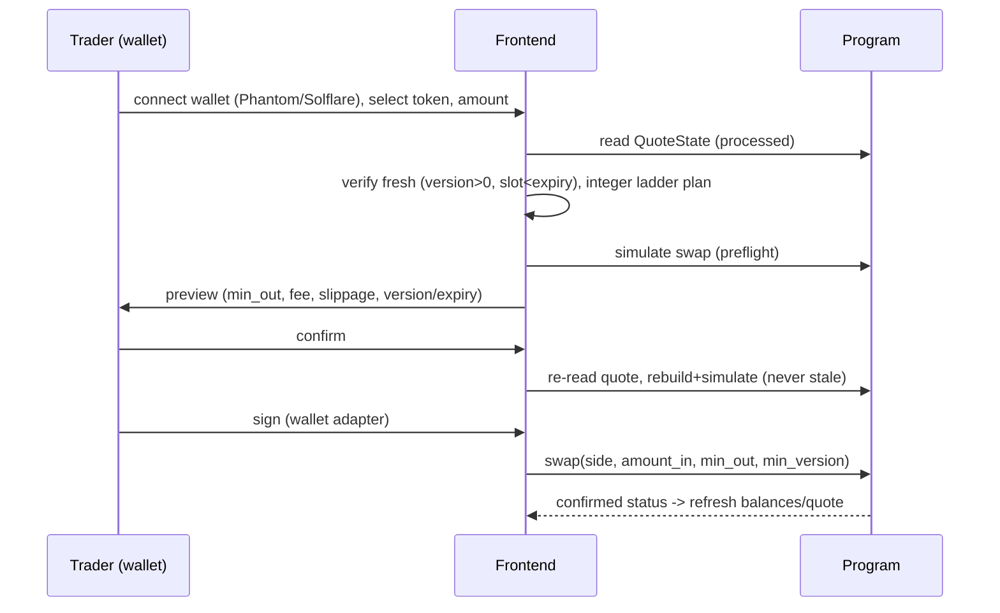
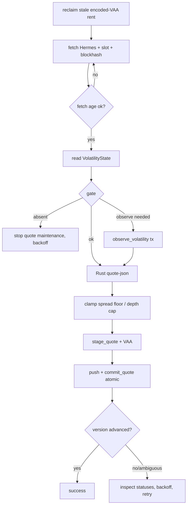
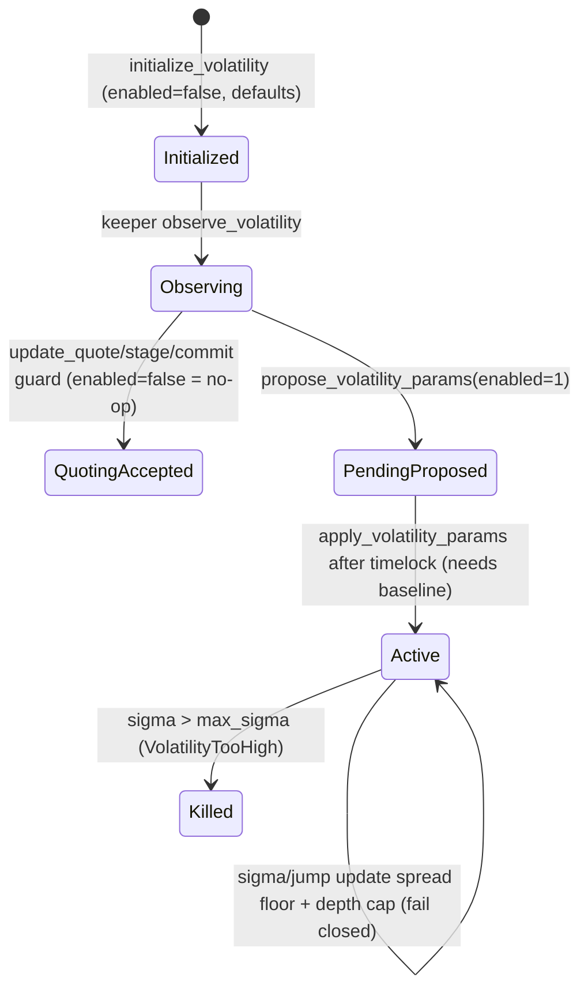

# ARBSWAP — PRESENTATION SOURCE OF TRUTH

> **Purpose of this document.** This is the complete knowledge base and content
> specification for a separate presentation-making agent. It describes ArbSwap's
> idea, research, architecture, on-chain program, mathematics, keeper, volatility
> engine, oracle integration, simulator, quantitative results, deployment,
> testing, limitations and demo flow, with repository file references.
>
> **Document status.** Reconstructed from the repository at working-tree commit
> `5a7d9bd` (`main`), including the uncommitted volatility subsystem and related
> in-progress files. Nothing here was executed on Devnet by this analysis; all
> numerical results are quoted from repository files with their experimental
> context. Where a value is a simulation/model output it is labelled as such.
>
> **Presentation use.** The slide blueprint is Section 20; instructions to the
> PPT-making agent are Section 23. Everything is sourced; the agent must not
> invent figures, signatures, TVL, returns or audit status.

---

## 1. Executive Summary

ArbSwap is an **open, oracle-anchored, two-sided market-making vault** on
Solana. It pairs pooled LP capital (a base/quote token pair, pro-rata shares,
epoch withdrawals) with an **active on-chain quoting engine**: a permissionless
keeper continuously computes a six-level bid/ask ladder around a **verified Pyth
reference price** and commits it on-chain as an expiring, versioned `QuoteState`.
A trader swap enforces `min_out`, `min_version`, quote expiry and a bounded ladder
walk in exact integer arithmetic, and reverts rather than filling worse.

The design combines: a Uniswap-v3-style constant-product ladder for execution, an
external fair-price anchor (Pyth SOL/USD), inventory-skewed reservation pricing, a
volatility-responsive spread **(implemented as an on-chain EWMA + jump engine)**,
and hard on-chain bounds on every keeper action. The economic hypothesis under
investigation is whether an inventory-aware, volatility-aware, bounded market
maker improves LP outcome versus a passive pool on real order flow; the repository
records that this specific hypothesis was **not demonstrated** on the available
real flow, and reports the losing regimes prominently.

**What is implemented:** a complete Anchor program (custody, shares, quote
lifecycle, swaps, breakers, timelock, keeper bond, volatility), a Rust quote
engine with bit-exact Python parity, a TypeScript live keeper with a staged-quote
pipeline and rent reclamation, a React frontend, a Python simulator/evaluator, an
aggregator adapter, and a deployed Devnet vault.

**Current deployment posture:** the base program and the volatility upgrade are
deployed on Devnet. Volatility **enforcement is currently disabled**; a timelocked
activation proposal is pending until slot `511663348` (documented ~24 h from the
proposal). No mainnet deployment exists.

---

## 2. Product Thesis and Problem

### 2.1 The problem

Passive AMM liquidity (constant-product pools) quotes a deterministic curve and
exposes LPs to **loss-versus-rebalancing (LVR)**, adverse selection and toxic flow:
the pool keeps filling at a stale curve while the fair price moves, so informed
flow systematically buys the pool's stale side. Concentrated-liquidity AMMs improve
capital efficiency but not the core problem. CEX market makers quote actively but
liquidity is provided against an order book rather than a pooled on-chain vault.
Oracle-priced exchanges reduce LVR but concentrate oracle risk and often capture
the spread centrally.

### 2.2 The ArbSwap approach

ArbSwap keeps pooled capital **but prices actively**:

- A keeper computes a bounded ladder around an external verified fair price and
  commits it on-chain with a version and an expiry.
- Spread widens with volatility, inventory imbalance, oracle confidence, oracle
  age and detected jumps; inventory skews the reservation price against the
  pool's own exposure.
- All of this is **bounded on-chain** so a keeper can never quote outside
  configured deviation, spread, capacity, slot-age and flow limits.
- Execution is **honest by construction**: the committed ladder is the executed
  ladder; `min_out` is enforced on-chain.

### 2.3 Positioning (what ArbSwap is and is not)

- **Not** a constant-product pool: it uses a six-level constant-product ladder
  priced around a reservation price, not a single invariant.
- **Not** a concentrated-liquidity AMM: liquidity is pooled balances with a
  bounded ladder, not user-placed ticks/ranges.
- **Not** a pure oracle exchange: the Pyth price is an anchor, bounded by
  `max_anchor_dev_bps` and step limits, and the executable ladder is inventory-
  and volatility-aware.
- **Not** a fully autonomous profitable market maker: the mechanism is
  implemented and bounded; the repository records that profitability and
  competitiveness are **not claimed** and the "beats passive" hypothesis was not
  shown on the available real-flow data.

### 2.4 One-sentence pitch

> ArbSwap is an open, oracle-anchored market-making vault that pairs pooled Solana
> liquidity with an on-chain, volatility-aware quoting engine whose price you are
> quoted is the price you get.

### 2.5 30-second explanation

> Passive AMMs lose money to informed flow because their price is stale. ArbSwap
> pools LP capital like an AMM, but a permissionless keeper reprices a six-level
> ladder around Pyth every update, widening spreads with volatility and skewing
> the price against its own inventory. Every quote is committed on-chain with a
> version and expiry, and every swap enforces a minimum output on-chain, so the
> protocol reverts instead of filling at a worse price. Keepers are bounded by
> hard on-chain limits and can never touch LP principal.

### 2.6 Two-minute technical explanation

> ArbSwap is a single Anchor program holding a WSOL/USDC vault. LPs deposit the
> pair and receive pro-rata shares; withdrawals settle by epoch. A keeper reads a
> Pyth SOL/USD update from Hermes, verifies it, computes a quote with the shared
> Rust `arb-math` crate (inventory skew `P_res = P·(1 − g·q)`, dynamic half-spread,
> a six-level constant-product ladder in Q64.64 fixed point), and commits it
> through a two-phase `stage_quote` → `commit_quote` path; the commit runs in the
> same transaction as the Pyth push-oracle write so the verified oracle value and
> the committed quote are atomic. The program re-validates every bound: Pyth feed
> id, freshness (`max_staleness_seconds`), confidence (`max_conf_bps`), the
> anchor-oracle deviation band, per-level offsets, spread bounds and step, ladder
> capacity against `utilization_max_bps·reserves`, `update_slot` age, and a
> per-window one-sided flow cap. An **on-chain volatility state** (EWMA variance
> short/medium + jump detector) can raise the spread floor and lower depth, and
> fails closed when enabled. A swap passes `min_out`/`min_version`; the program
> walks the ladder with exact integer math and reverts on `SlippageExceeded` or
> `CapacityExceeded`. A permissionless state-only breaker pauses quoting; admin
> actions are timelocked. The math is mirrored bit-exactly in Python and pinned by
> 997 golden vectors.

### 2.7 One-paragraph research thesis

> The research thesis is that a bounded, oracle-anchored, inventory- and
> volatility-aware ladder can keep execution honest and LP loss bounded without
> requiring trust in the keeper, and that the design's economics can be evaluated
> against a passive pool on real price paths. The pre-registered evaluation
> (`docs/P1_PREREGISTRATION.md`) specifies the "beats passive" hypothesis with
> confidence intervals on real aggTrades flow; the recorded outcome was that the
> strict hypothesis was **not met**, with the negative and zero-share regimes
> reported.

### 2.8 One-paragraph startup description

> ArbSwap is a DeFi protocol that turns pooled liquidity into an actively managed
> on-chain market maker. Instead of a fixed curve, a keeper repriced by an
> external oracle quotes a bounded multi-level ladder that adapts to volatility
> and inventory, and every fill is enforced on-chain against a quoted minimum. It
> targets LPs who want AMM-style deposit/withdraw UX without unbounded adverse
> selection, and traders/aggregators who want a transparent, versioned quote that
> cannot be front-run by a hidden spread. The protocol is Devnet-deployed with a
> full lifecycle, keeper, frontend and simulation stack.

### 2.9 Strongest technical differentiators

1. **Honest execution by construction** — the committed ladder is the executed
   ladder; `min_out`/`min_version`/expiry enforced on-chain; no quote-versus-fill
   spread.
2. **Bounded, never-trusted keepers** — thirteen-plus on-chain bounds; the keeper
   can move prices only inside them.
3. **On-chain volatility engine** — EWMA variance (short/medium), jump detection
   with cooldown, spread floor and depth cap, all in Q64.64 with fail-closed
   guards and a timelocked activation.
4. **Two-phase atomic quoting** — `stage_quote`/`commit_quote` with the Pyth
   push in the same transaction, replay-proof nonces, staged-state snapshots.
5. **Bit-exact cross-language math** — 997 golden vectors pinning Rust `arb-math`
   to the Python reference.
6. **Evidence-first culture** — a claims ledger, pre-registered study, mutation
   tables, and prominently documented losing regimes.

### 2.10 Primary research question and subquestions

- **Primary:** Can an open, oracle-anchored, bounded market-making vault deliver
  honest execution and bounded LP loss on real order flow, and can its economics
  be measured against a passive pool?
- **Subquestions:** Does inventory-aware pricing reduce LP variance? Does
  volatility-responsive spreading improve risk-adjusted outcome? Do the on-chain
  bounds preserve honesty without making the keeper economically useless? What is
  the compute cost of the on-chain quote/swap path?

---

## 3. Research Background

### 3.1 Sources cited in the repository

The repository's reading list lives in `MATH.md:394-411`, `MasterPlan.md:427-440`
and `BuilderPlan.md:667-702`. Only details actually recorded are reproduced.

| Title | Authors (as recorded) | Year | Cited at |
|---|---|---|---|
| Automated Market Making and Loss-Versus-Rebalancing (LVR), arXiv:2208.06046 | Milionis, Moallemi, Roughgarden, Zhang | — | `MATH.md:395`, `MasterPlan.md:428`, `ASSUMPTIONS.md:34` |
| Optimal Dynamic Fees in Automated Market Makers, arXiv:2506.02869 | Baggiani, Herdegen, Sanchez-Betancourt | — | `MATH.md:399`, `MasterPlan.md:429` |
| Fees in Automated Market Makers, arXiv:2406.12417 | Alexander, Fritz | — | `MATH.md:400`, `MasterPlan.md:431` |
| ZeroSwap, arXiv:2310.09413 | — | — | `MATH.md:402`, `MasterPlan.md:434` |
| Adaptive Curves for Optimally Efficient Market Making, arXiv:2406.13794 | — | — | `MATH.md:403`, `MasterPlan.md:435` |
| Active Liquidity On Chain (propAMMs), arXiv:2609.38056 | Solmaz, Heimbach, Milionis | — | `MATH.md:404`, `MasterPlan.md:427`, `P1_PREREGISTRATION.md:13` |
| PropAMM Shenanigans (0x.org/blog post) | 0x | — | `MATH.md:405`, `MasterPlan.md:87` |
| Blockchain price oracles: Accuracy and violation recovery | Nadler, Schuler, Schär | 2026 | `MATH.md:406`, `ASSUMPTIONS.md:16` |
| Oracle-Parametrized Constant Function Market Makers, arXiv:2609.33799 | Amini, Feinstein | 27 Sep 2026 | `MATH.md:411`, `ASSUMPTIONS.md:50` |
| High-frequency trading in a limit order book | Avellaneda, Stoikov | 2008 | `MATH.md:398`, `ASSUMPTIONS.md:123` |
| Bid, Ask and Transaction Prices in a Specialist Market | Glosten, Milgrom | 1985 | `MATH.md:401`, `MasterPlan.md:440` |
| Uniswap v3 whitepaper | — | — | `MATH.md:394`, `ASSUMPTIONS.md:12` |
| Uniswap v2 whitepaper | — | — | `MATH.md:409`, `ONE_SIDED_DEPOSIT_WITHDRAWAL_PLAN.md:162` |
| ERC-4626 standard | — | — | `MATH.md:410`, `BuilderPlan.md:699` |
| Lifinity docs + Solana Compass | — | — | `PRIOR_ART.md:9-19`, `ASSUMPTIONS.md:148` |
| Pyth Core docs; Pyth Lazer announcement | — | — | `MATH.md:407`, `ASSUMPTIONS.md:65` |
| Orca Whirlpools source (license note) | — | — | `BuilderPlan.md:669`, `ASSUMPTIONS.md:8` |
| Allium/Praxial "Borrowed Machinery"; HumidiFi (Solana Compass) | — | — | `MasterPlan.md:436`, `BuilderPlan.md:683` |
| Sadeghi & Feinstein, liquidation dynamics, arXiv:2602.12104 | Sadeghi, Feinstein | — | `BuilderPlan.md:698` |

### 3.2 Research-to-implementation mapping

| Research idea | ArbSwap design decision | Implementation | Metric |
|---|---|---|---|
| LVR / adverse selection (Milionis et al.) | active quoting + depth throttle to limit stale-curve fills | `vault/math`, keeper throttle; simulator LVR `σ²/8·V·T` | LVR per window (`P1_RESULTS.md`) |
| PropAMM active quoting (Solmaz et al.) | keeper-quoted ladder + on-chain bounds | `vault/program` quote lifecycle, `vault/keeper` | routed volume/fill share (model) |
| Avellaneda–Stoikov inventory skew | reservation price `P_res = P(1 − g·q)` | `vault/math/src/quote.rs`, keeper | quiet half-spread decomposition |
| Glosten–Milgrom adverse selection | inventory/volatility-sensitive spread | dynamic half-spread in `FORMULA.md` | spread capture vs adverse selection |
| Uniswap v3 tick math | constant-product segments on a sqrt-price ladder | `vault/math/src/quote.rs` walk | swap CU |
| Oracle accuracy (Nadler et al.) | strict on-chain Pyth freshness/conf bounds | `validate_quote_update` (`lib.rs:1922`) | oracle-guard tests |
| Oracle-parametrized CFMM (Amini–Feinstein) | external fair-price anchor with bounded deviation | anchor band `max_anchor_dev_bps` | anchor-guard tests |
| EWMA volatility | on-chain variance short/medium + jump cooldown | `vault/math/src/volatility.rs`, `observe_volatility` | σ bps, jump flag |
| Optimal dynamic fees / fees in AMMs | fee split + adaptive spread (not dynamic fee) | `fee_bps`, `insurance/keeper/protocol` split | fee buckets, CU |

### 3.3 Design choices explained

- **Familiar ladder math instead of a novel curve** keeps execution auditable and
  lets the same `arb-math` back the program, keeper and aggregator bit-exactly.
- **Bounded inventory skew** (not free inventory optimisation) keeps the keeper
  provably inside on-chain bands.
- **External price anchoring with a deviation band** prevents the keeper from
  quoting an arbitrary price while still allowing inventory skew.
- **Volatility-aware spread** is expressed as a floor/depth response rather than a
  full dynamic-fee curve, keeping the on-chain surface small and bounded.

---

## 4. Architecture Overview

### Diagram A — High-level architecture

```mermaid
flowchart TB
  U[Trader / LP] -->|wallet| FE[Frontend app/]
  FE -->|RPC reads + tx| RPC[Solana RPC]
  K[Keeper<br/>Rust engine + TS driver] -->|stage/commit/observe tx| RPC
  K -->|Hermes fetch| HERMES[Pyth Hermes]
  RPC --> PROG[ArbSwap Program<br/>2mwpYHpZ...]
  PROG --- VAULT[(Vault PDA)]
  PROG --- CFG[(Config PDA)]
  PROG --- QS[(QuoteState PDA)]
  PROG --- VOL[(VolatilityState PDA<br/>b"vol", vault)]
  PROG --- BOND[(KeeperBond / KeeperReward)]
  PROG --- TIX[(Deposit/Withdraw tickets)]
  PROG -->|verify| PYTH[Pyth push oracle + Wormhole VAA]
  IDX[Indexer + Analytics] -->|events| RPC
  FE -->|artifacts/*.json| IDX
```

**Key principle.** On-chain state is authoritative; the keeper and frontend are
readers/writers that can only move within program-enforced bounds.

### Diagram B — End-to-end quote lifecycle

```mermaid
sequenceDiagram
  participant H as Hermes (Pyth)
  participant K as Keeper
  participant P as Program
  K->>H: fetch SOL/USD update
  H-->>K: price, conf, publish_time, VAA
  K->>K: freshness/confidence/feed checks (skip if too old)
  K->>P: observe_volatility (own tx) [if baseline/stale]
  P-->>K: VolatilityState updated (EWMA, jump, nonce++)
  K->>K: Rust quote-json -> QuoteUpdate body
  K->>P: stage_quote(update, nonce)  (Tx A)
  K->>P: Wormhole VAA post            (Tx V)
  K->>P: updatePriceFeed + commit_quote (Tx B, atomic)
  P-->>K: QuoteState.version++ , expiry_slot = slot + expiry_slots
  Note over P: quote live until expiry_slot; then QuoteExpired
```

### Diagram C — Swap execution



### Diagram D — Keeper sequence



### Diagram E — Volatility lifecycle



**What the viewer should understand:** the volatility PDA is a first-class on-chain
object; enforcement is opt-in via a timelock; and when disabled the quote path is
byte-identical to a deployment without volatility.

---

## 5. Program and Account Model

- **Program id:** `2mwpYHpZ2TS6TjG3CbKBqQAwUv4hw7XrAbg4Kb6hyiNm` (`lib.rs:8`,
  `Anchor.toml`). Anchor program, single file `vault/program/src/lib.rs`.
- **Cluster:** Devnet. `LEVELS = 6`; `TIMELOCK_SLOTS = 216_000` (~24 h at
  400 ms); `MAX_EXPIRY_SLOTS = 600`; `MAX_STAGE_AGE_SLOTS = 25`;
  `MAX_LEVEL_OFFSET_BPS = 500`; `BPS_DENOM = 10_000`.
- **Fixed point:** Q64.64 prices; no floats on-chain; integer widths `u16/u32/u64`
  for bps/slots and `u128` for sqrt prices and EWMA variances.

### 5.1 State accounts and PDAs

| Account | Seeds | Key fields |
|---|---|---|
| `ProgramConfig` | `[b"program"]` | deploy admin |
| `Vault` | `[b"vault", base_mint, quote_mint]` | admin, mints, reserves, share_mint/lock, `total_shares`, six fee buckets, `epoch`, `epoch_start`, `status` |
| `Config` | `[b"config", vault]` | keeper, treasury, `pyth_feed_id`, fee split, all bounds, `min_bond`, pending admin + activate slot |
| `QuoteState` | `[b"quote", vault]` | `version`, `update_slot`, `expiry_slot`, anchor/reservation sqrt prices, spread, 2×6 levels, oracle price/conf/publish, flow window, edge tracker, appended `keeper` author |
| `PendingQuote` | `[b"pending_quote", vault, keeper]` | staged update, nonce, `committed_nonce`, stage slot, staged-state snapshots |
| `PendingConfig` | `[b"pending", vault]` | `admin`, `activate_slot`, `ParamsUpdate` |
| `PendingClaim` | `[b"claim", vault]` | fee-claim kind + activate slot |
| `DepositTicket` | `[b"dep", vault, user]` | shares, activate slot |
| `WithdrawTicket` | `[b"wd", vault, user]` | shares, epoch |
| `KeeperBond` | `[b"keeper", vault, keeper]` | bond, slashed, unbond amount/ready slot; bond token vault `[b"bond", vault]` |
| `KeeperReward` | `[b"reward", vault, keeper]` | per-keeper base/quote accrual |
| `VolatilityState` | `[b"vol", vault]` | EWMA short/medium, last price/publish/slot, nonce, jump flag + cooldown, params, `enabled` (175 bytes) |
| `PendingVolatilityParams` | `[b"vol_pending", vault]` | admin, activate slot, `VolatilityParams`, `enabled` (102 bytes) |

### 5.2 QuoteState and VolatilityState fields

`QuoteUpdate` payload (`lib.rs:2308`): `update_slot:u64, oracle_publish_time:i64,
oracle_conf_bps:u32, anchor_sqrt_price:u128, p_res_sqrt:u128, half_spread_bps:u32,
ask_extra_bps:u32, bid_extra_bps:u32, depth_mult_bps:u32, offsets_bps:[u32;6],
weights_bps:[u32;6], ask_levels:[LevelUpdate;6], bid_levels:[LevelUpdate;6]`; the
volatility guard parameters come from the PDA, not the payload.
`LevelUpdate = { sqrt_lo:u128, sqrt_hi:u128, liquidity:u128 }`.

`VolatilityState` (`lib.rs:2541`): `short_ewma_q64, medium_ewma_q64` (Q64.64
per-second variance), `last_price_q64`, `last_publish_time`, `last_observation_slot`,
`observation_nonce`, `jump_detected`, `jump_until_slot`, `short_lambda_bps`,
`medium_lambda_bps`, `jump_multiple`, `max_sigma_q64`, `jump_cooldown_slots`,
`vol_spread_coeff_bps`, `vol_depth_coeff_bps`, `max_observation_age_slots`,
`enabled`, `bump`.

`ParamsUpdate` (`lib.rs:2224`): fee/insurance/keeper/protocol bps, oracle
staleness/conf, anchor step/deviation, spread min/max/step, quote size, inventory,
utilization, unbond cooldown, update-slot age, edge window/loss, flow window/cap,
expiry slots. (`min_bond`/`keeper` are not part of `ParamsUpdate`.)

`VolatilityParams` (`lib.rs:2572`): `short_lambda_bps, medium_lambda_bps,
jump_multiple, max_sigma_q64, jump_cooldown_slots, vol_spread_coeff_bps,
vol_depth_coeff_bps, max_observation_age_slots`.

### 5.3 Authority model

- **Admin** (vault.admin): initialize, timelocked parameter changes, admin
  rotation, breaker reset, wind-down, keeper slashing, fee-claim execution,
  volatility initialize/propose/apply. Cannot seize LP reserves.
- **Keeper** (`config.keeper`, or any bond-qualified keeper when `min_bond > 0`):
  may only submit `update_quote` / `stage_quote` / `commit_quote` / `observe_volatility`,
  all bounded on-chain.
- **Permissionless:** `trip_breaker` (state-only), `crank_epoch`, `observe_volatility`.
- **Traders/LPs:** swaps, deposits, withdrawals.

### 5.4 Token decimals and price normalization

There are two price units: the human oracle price (quote per base, e.g. USDC per
SOL) and the executable token-unit price (quote atoms per base atom). The program
derives the token-unit price on-chain from the **verified** Pyth value and the
vault's own bound mints:
`P_token = P_human · 10^(quote_decimals − base_decimals)`; `update_quote` requires
the submitted `oracle_price` to equal the on-chain value, and the mint accounts
are address-bound to the vault (`docs/PIPELINE.md:30-57`).

---

## 6. Instruction Reference

Instruction handlers live in `vault/program/src/lib.rs`. Signer/`mut`/constraint
flags below are those declared in the `#[derive(Accounts)]` contexts.

| Instruction | Purpose | Required accounts (order) | Important checks | State changed | Principal failure modes |
|---|---|---|---|---|---|
| `initialize_program` (`:62`) | set deploy admin | admin(mut,signer), program_config(init `[b"program"]`), system | signer | ProgramConfig | already initialized |
| `initialize_vault` (`:270`) | create vault + config + quote + reserves + share mint | admin(signer), program_config, vault(init), config(init), quote_state(init), base_mint, quote_mint, base_reserve(init), quote_reserve(init), share_mint(init), share_lock(init), token, system, rent | params valid, mints bound | all init accounts | InvalidParams/InvalidMint |
| `initialize_volatility` (`:73`) | create `[b"vol",vault]`, defaults, `enabled=false` | admin(signer)=vault.admin, vault, volatility_state(init), system | admin; params valid; all-zero → defaults | VolatilityState | InvalidVolatilityParams |
| `deposit` (`:449`) | pro-rata share mint | user(signer), vault, config, base/quote reserves, share_mint, share_lock, user_base/user_quote/user_shares, deposit_ticket(init), token, system | status Active, amounts>0, `shares≥min_shares`, warmup ticket | reserves, shares, ticket | InvalidAmount, WarmupNotElapsed |
| `request_withdraw` (`:598`) | queue epoch ticket | user(signer), vault, share_lock, deposit_ticket, user_shares, withdraw_ticket(init), token, system | shares>0 | ticket, shares escrow | InvalidAmount |
| `crank_epoch` (`:626`) | advance epoch | vault, config | `now ≥ epoch_start+epoch_slots` | vault.epoch | EpochNotReached |
| `claim_withdraw` (`:647`) | pro-rata payout | user(signer), vault, reserves, share_mint, share_lock, withdraw_ticket, user_base/user_quote, token | `ticket.epoch ≤ vault.epoch` | reserves, ticket | EpochNotReached |
| `update_quote` (`:736`) | direct quote write | keeper(signer), vault, config, quote_state, price_update, keeper_bond, reserves, base_mint, quote_mint, **volatility_state** | all quote bounds + volatility guard | QuoteState | InvalidOracle, AnchorTooFarFromOracle, VolatilitySpreadTooLow, … |
| `stage_quote` (`:828`) | phase-1 staged write | keeper(signer,mut), vault, config, quote_state, pending_quote(init), reserves, keeper_bond, **volatility_state**, system | nonce monotonic, bounds, volatility guard fail-fast | PendingQuote | StalePendingQuote, StageAge |
| `commit_quote` (`:901`) | phase-2 atomic commit | keeper(signer,mut), vault, config, quote_state(mut), pending_quote(mut), price_update, reserves, keeper_bond, base_mint, quote_mint, **volatility_state** | re-validate all + push oracle in same tx | QuoteState | StalePendingQuote, StagedStateChanged, InvalidOracle |
| `swap` (`:985`) | execute against ladder | trader(signer,mut), vault(mut), config, quote_state(mut), reserves(mut), trader_base, trader_quote, keeper_reward(init), system, token | status, version, expiry, size, flow cap, ladder walk, `out≥min_out` | reserves, quote_state flow, fee buckets, reward | QuoteExpired, VersionTooOld, SlippageExceeded, CapacityExceeded, FlowCapExceeded |
| `observe_volatility` (`:190`) | update EWMA/jump | observer(signer), vault, config, volatility_state(mut), price_update, base_mint, quote_mint | freshness, `publish_time` monotonic, conf | VolatilityState | InvalidOracle, StaleOracle, InvalidVolatilityParams |
| `propose_volatility_params` (`:120`) | timelock proposal | admin(signer), vault, pending_volatility(init_if_needed), system | admin, params valid | PendingVolatilityParams | InvalidVolatilityParams |
| `apply_volatility_params` (`:150`) | activate after timelock | admin(signer), vault, volatility_state(mut), pending_volatility(mut) | `slot ≥ activate_slot`, baseline if enabling | VolatilityState + pending | TimelockNotElapsed, VolatilityNotReady |
| `bond_keeper` (`:1481`) | bond quote tokens | keeper(signer), vault, quote_mint, keeper_quote, bond_vault(init), keeper_bond(init), token, system | amount>0 | bond, vault | InsufficientBond |
| `unbond_keeper` (`:1503`) | two-phase unbond | keeper(signer), vault, config, quote_mint, keeper_quote, bond_vault, keeper_bond, token | cooldown | bond, unbond fields | NotBonded |
| `slash_keeper` (`:1559`) | admin slash during cooldown | admin(signer), vault, quote_reserve, keeper, keeper_bond, bond_vault, token | admin, slashed window | bond, reserve | Unauthorized |
| `claim_keeper_reward` (`:1609`) | per-keeper fee claim | keeper(signer), vault, keeper_reward, reserves, keeper_base/keeper_quote, token | reward>0 | reward, reserves | InvalidAmount |
| `trip_breaker` (`:1268`) | permissionless pause | vault, config, quote_state | state-only conditions | vault.status | BreakerConditionNotMet |
| `reset_breaker` (`:1296`) | admin unpause | admin(signer), vault | admin | vault.status | Unauthorized |
| `wind_down` (`:1311`) | admin wind-down | admin(signer), vault | admin | vault.status | Unauthorized |
| `set_params` (`:1322`) | timelock params | admin(signer), vault, config, pending_config(init), system | admin, params valid | PendingConfig | InvalidParams |
| `apply_params` (`:1355`) | apply params after timelock | admin(signer), vault, config(mut), pending_config(mut) | `slot ≥ activate_slot` | Config + pending | TimelockNotElapsed |
| `propose_admin`/`accept_admin`/`cancel_admin` (`:1421`/`:1440`/`:1464`) | rotate admin | admin/new_admin(signer), vault, config | admin; pending | Config.pending_admin | Unauthorized, NoPendingAdmin |
| `propose_fee_claim`/`execute_fee_claim` (`:1680`/`:1706`) | timelocked treasury claim | admin(signer), vault, config, pending_claim, reserves, treasury ATAs, token | admin,`slot≥activate`, fixed treasury | reserves, pending | TimelockNotElapsed, InsuranceNotClaimable |
| `migrate_quote_state` (`:390`) | expand legacy QuoteState length | payer(signer), vault, quote_state, system | length migration | QuoteState | UnsupportedAccountLength |

**Quote/swap account ordering (volatility delta).** `update_quote` appends
`volatility_state` last; `stage_quote` places it immediately before
`system_program`; `commit_quote` places it last (Wormhole account may trail and is
ignored by Anchor). `swap` does **not** load the volatility PDA — the guard is
applied at quote time, so a committed quote remains executable.

---

## 7. Mathematical Model

All formulas below are the ones implemented in the source (Rust
`vault/math/src/`, `vault/program/src/lib.rs`) and documented in `MATH.md` /
`docs/FORMULA.md` / `docs/VOLATILITY_MATH_SPEC.md`. Q64.64 denotes unsigned
fixed-point with 64 fractional bits; bps = basis points (1 bps = 0.01 %).

### 7.1 Inventory skew

- **Equation:** `q = (B·P − Q) / (B·P + Q) ∈ [−1, 1]`.
- **Variables:** `B` base reserve, `Q` quote reserve, `P` normalized token-unit
  oracle price.
- **Units:** dimensionless.
- **Intuition:** positive when the vault holds relatively more base value; the
  vault leans its price against that exposure.
- **Implementation:** keeper quote computation (`vault/keeper/src/lib.rs::compute_quote`),
  mirrored in the Python reference.
- **Illustration:** if `B·P = 150`, `Q = 50`, then `q = 0.5`.

### 7.2 Reservation price

- **Equation:** `P_res = P·(1 − g·q)`.
- **Variables:** `g` inventory coefficient (kept small, e.g. `inventory_coeff`
  used by the simulator = 0.001), `q` above.
- **Intuition:** skew the mid to attract flow that reduces inventory.
- **On-chain bound:** the anchor and every level are bounded to `P_res ± band`
  (`max_inventory_bps`, `max_anchor_dev_bps`).

### 7.3 Dynamic half-spread

- **Equation:** `s = clamp(s_floor + a1·σ + a2·|q| + a3·(c/P) + a4·max(0, age−grace) + a5·jump, s_min, s_max)`.
- **Variables:** `σ` volatility, `c/P` relative confidence, `age` oracle age; the
  coefficients are design parameters.
- **Units:** bps.
- **On-chain enforcement:** `min_spread_bps ≤ half_spread_bps ≤ max_spread_bps`,
  and `|Δhalf_spread| ≤ max_spread_step_bps` per update.

### 7.4 Ladder

- Levels `k = 0..5` with offsets `[2, 5, 10, 20, 40, 80]` bps and weights
  `[1000, 1500, 2000, 2000, 2000, 1500]` summing to `10_000`.
- `ask_lo/hi_k = P_res·(1 + s + ask_extra + offset_k)`,
  `bid_lo/hi_k = P_res·(1 − s − bid_extra − offset_k)`.
- Per-level capacity: `base_cap_k = w_k·depth_mult·utilization_max·B`,
  `quote_cap_k = w_k·depth_mult·utilization_max·Q`.

### 7.5 Ladder walk (`arb_math::walk_ladder`)

- `base_capacity = floor(L·Δ/(lo·hi))`, `quote_capacity = floor(L·Δ/2¹²⁸)`,
  `Δ = hi − lo`.
- `buyBase`: `delta = floor(q_in·2¹²⁸/L)`, `sqrt(P') = sqrt_lo + delta`,
  `out = floor(floor(L·delta/lo)/p)`.
- `sellBase`: `p' = ceil(hi·L/(L + x·hi))`, `out = floor(L·(hi − p')/2¹²⁸)`.
- Fees: `fee = ceil(amount_in·fee_bps/10⁴)`, `net = amount_in − fee`.
- On-chain: `require!(remaining == 0)` → `CapacityExceeded`;
  `require!(out ≥ min_out)` → `SlippageExceeded`.

### 7.6 Share math

- First deposit: `shares = floor(sqrt(base·quote)) − min_liquidity` (locked).
- Later: `shares = min(floor(dB·S/B), floor(dQ·S/Q))`; pull is ceil-rounded.
- Withdraw: `floor(shares·B/S)`, `floor(shares·Q/S)`.

### 7.7 Fixed point and rounding

`sqrt_q64(v) = floor(isqrt(v << 64))` with a 192-bit radicand; `mul_q64`,
`div_q64`, `recip_q64` helpers; `inv_sqrt_q64_ceil` rounds capacity estimates up
so they never understate exact capacity. Rounding always favors the vault (payout
down, receipt up). Signed division truncates toward zero.

### 7.8 EWMA volatility (implemented)

From `vault/math/src/volatility.rs`:

- **Return (absolute simple, Q64.64, floor):**
  `r = floor(|P_t − P_{t−1}|·2⁶⁴ / P_{t−1})`.
- **Step count:** `n = clamp(round(dt_millis/1000), 1, MAX_EWMA_STEPS=300)`.
- **Innovation:** `r² = mul_q64(r, r)`, `innovation = floor(r² / n)`.
- **EWMA (per step, bps decay truncated):**
  `decay = floor(decay_bps·2⁶⁴/10⁴)`,
  `one_minus = floor((10⁴ − decay_bps)·2⁶⁴/10⁴)`,
  `v' = mul_q64(decay, v) + mul_q64(one_minus, innovation)`.
  Separate short (`λ_short`) and medium (`λ_medium`) series.
- **Sigma:** `σ = sqrt_q64(v_short)`; `σ_bps = floor(σ·10⁴/2⁶⁴)`.
- **Jump:** `jump = (σ > 0) ∧ (r > jump_multiple_display · σ)` (integer multiple),
  then `jump_until_slot = slot + jump_cooldown_slots`; jump is active while
  `jump_detected ∨ slot < jump_until_slot`.

### 7.9 Volatility-driven spread floor and depth cap (implemented)

- `effective_bps = σ_bps · (jump_active ? jump_multiple : 1)`.
- `vol_floor = ceil(effective_bps · vol_spread_coeff_bps / 10⁴)`;
  `spread_floor = max(config.min_spread_bps, vol_floor)`.
- `depth_cut = ceil(effective_bps · vol_depth_coeff_bps / 10⁴)`;
  `depth_cap = 10⁴ − min(10⁴, depth_cut)`.
- `mul_bps_ceil(a,bps) = ceil(a·bps/10⁴)`.

### 7.10 Oracle deviation and confidence

- `publish_time` equality with the submitted value; freshness via
  `get_price_no_older_than(clock, max_staleness_seconds)`;
  `conf_bps ≤ max_conf_bps`.
- Anchor deviation `≤ max_anchor_dev_bps`; per-update anchor step
  `≤ max_anchor_step_bps`.

### 7.11 Worked hypothetical example (illustrative only — not a Devnet event)

Given `P = 150.0` (SOL/USD), `B·P = 150`, `Q = 50`, `g = 0.001`, `σ = 2 bps`,
`min_spread = 2 bps`, `vol_spread_coeff = 1000`, `jump = false`:
`q = 0.5`; `P_res = 150·(1 − 0.001·0.5) = 149.925`; `vol_floor = ceil(2·1000/10⁴)
= 0.2 bps`; `spread_floor = max(2, 0.2) = 2 bps`; the ladder is then built around
`P_res` with offsets `[2,5,10,20,40,80]`.

---

## 8. Inventory and Liquidity Management

- **Pooled balances, not ticks.** Liquidity is held as pooled `base_reserve`/
  `quote_reserve` balances owned by the vault PDA; the ladder is a *quoting*
  structure, not user-placed ranges. Uniswap v3 tick math is used as the
  constant-product-segment **execution primitive** on a sqrt-price ladder, not as
  a set of LP positions.
- **Inventory feed-forward.** `q` (Section 7.1) shifts `P_res`; the keeper's
  next quote therefore leans against inventory. Reserves update after every swap.
- **Depth and capacity.** Per-level capacity is bounded by `utilization_max_bps`
  of fee-net available reserves; the program rejects a ladder whose capacity
  exceeds the bound (`UtilizationExceeded`) and a swap that cannot fully fill
  (`CapacityExceeded`).
- **Spread response.** Spread widens with `|q|`, `σ`, confidence, age and jumps
  (Section 7.3, 7.9). Extreme quotes are prevented by `min/max_spread` and the
  anchor/level bands.
- **At a boundary.** If inventory approaches a band edge, the skew and bounds
  cause the keeper to quote wider/less; if the ladder cannot fill, the swap
  reverts. When the volatility guard is active and the quote would breach the
  floor/cap, the keeper skips rather than quoting outside the bounds.
- **Rebalancing.** There is **no on-chain liquidity migration or automatic
  rebalancing**. Inventory is managed by pricing and by traders' flow; the keeper
  cannot move reserves. This is quote management, not liquidity placement.
- **Passive vs inventory/volatility-aware (hypothetical illustration):** a
  passive pool at `P = 150` holds a symmetric curve; ArbSwap at `q = 0.5` shifts
  the mid down (to reduce base exposure) and widens the spread with `σ`, so it
  quotes less when toxic flow is likely and more competitively when calm.

**Trade-offs.** Tighter spreads win fill share but raise adverse-selection
exposure; wider spreads reduce toxicity but lose volume; deeper depth increases
capital efficiency but concentrates inventory risk; the protocol may decline to
quote (wider/skip) in stressed regimes.

---

## 9. Volatility Engine

The volatility subsystem is the newest implemented feature. Files:
`vault/math/src/volatility.rs` (+ `vault/math/tests/volatility.rs`),
`vault/program/src/lib.rs` (VolatilityState/PendingVolatilityParams + three
instructions + `volatility_guard_core`),
`vault/program/tests/litesvm_volatility.rs`, `scripts/devnet/volatility.ts`
(+ `volatility.test.ts`), `scripts/devnet/volatility_admin.ts`,
`scripts/devnet/volatility_apply_daemon.ts`, the frontend
`app/src/chain/volatility.ts` + `useVolatilityRegime.ts`, and docs
`VOLATILITY_MATH_SPEC.md`, `VOLATILITY_IMPLEMENTATION_STATUS.md`,
`VOLATILITY_ROLLOUT.md`, `VOLATILITY_DEVNET_DEPLOYMENT.md`.

**Purpose.** Persist a tamper-resistant, replay-proof on-chain estimate of the
oracle price's variability so the quote path can enforce a **spread floor** and a
**depth cap** that respond to volatility and jumps, rather than trusting the
keeper's own estimate.

**Observation rules (`observe_volatility`).** Permissionless; requires a fresh,
confidence-checked Pyth update; enforces `publish_time > last_publish_time`
(replay-proof, monotonic) and confidence `≤ max_conf_bps`; computes `dt` from the
stored publish time (0 on first observation); updates short/medium EWMA, last
price/publish/slot, jump flag and cooldown, increments `observation_nonce`, emits
`VolatilityObserved`. No nonce argument — the counter is internal.

**Short/medium EWMA.** Separate decay constants `short_lambda_bps = 9400` (0.94)
and `medium_lambda_bps = 9900` (0.99); per-second innovation `r²/n`; the
time-normalised step loop caps at 300 steps for large gaps (Section 7.8).

**Jump detection.** `jump_multiple = 4`; on a jump `jump_until_slot = slot +
jump_cooldown_slots` (default 1800). Active while flagged or within cooldown.

**Kill switch.** `sigma ≤ max_sigma_q64` (default `1<<60` ≈ 0.0625 per second);
otherwise `VolatilityTooHigh`.

**Spread/depth response.** Section 7.9; floor and cap derived from `σ_bps`
(multiplied by `jump_multiple` while a jump is active).

**Initialization.** `initialize_volatility` creates `[b"vol", vault]`, copies
defaults (all-zero params → `DEFAULT_VOLATILITY_PARAMS`) and **forces
`enabled = false`**, so the guard is a no-op until a timelocked apply.

**Proposal/timelock.** `propose_volatility_params(params, enabled)` is admin-only,
writes `[b"vol_pending", vault]` with `activate_slot = slot + 216_000`, and does
not touch the live account. `apply_volatility_params` is admin-only, requires
`slot ≥ activate_slot`, requires a verified baseline (`last_price_q64 > 0`) when
enabling (else `VolatilityNotReady`), copies params + `enabled`, preserves
EWMA/nonce/jump, and consumes the proposal (`activate_slot = u64::MAX`).

**Enabled/disabled behavior.** Disabled → `volatility_guard_core` returns
immediately (quote path identical to a deployment without volatility), though the
PDA is still structurally required by the ABI. Enabled → fail-closed.

**Missing-PDA behavior.** All three quote-writing instructions require the PDA;
omitting it fails Anchor account resolution (`AccountNotEnoughKeys`, 3005) before
the handler. The keeper treats an absent PDA as `blocked-absent` and **stops quote
maintenance** (no legacy fallback).

**Recovery.** A missing/unusable PDA is recovered by re-running
`initialize_volatility`; a failed first observation is retried until it lands;
enabling before a baseline is refused. `observe_volatility` can be retried
permissionlessly.

**Fail-closed rationale.** Enabling enforcement without a fresh, verified
observation (or letting a stale observation persist) would let a quote be priced
without a real volatility estimate, so the guard reverts rather than degrade.

### 9.1 Volatility state fields and parameters

| Field / param | Type | Default | Units | Effect / bound |
|---|---|---|---|---|
| `short_ewma_q64` | u128 | 0 | Q64.64 variance | short EWMA state |
| `medium_ewma_q64` | u128 | 0 | Q64.64 variance | medium EWMA state |
| `last_price_q64` | u128 | 0 | Q64.64 price | baseline presence (0 = none) |
| `last_publish_time` | i64 | 0 | unix s | monotonic replay gate |
| `last_observation_slot` | u64 | 0 | slot | staleness reference |
| `observation_nonce` | u64 | 0 | count | monotonic observations |
| `jump_detected` / `jump_until_slot` | bool/u64 | false/0 | slot | jump flag + cooldown |
| `short_lambda_bps` | u32 | 9400 | bps | short decay |
| `medium_lambda_bps` | u32 | 9900 | bps | medium decay |
| `jump_multiple` | u32 | 4 | × | jump threshold multiplier |
| `max_sigma_q64` | u128 | `1<<60` | Q64.64 | kill switch |
| `jump_cooldown_slots` | u64 | 1800 | slots | post-jump cooldown |
| `vol_spread_coeff_bps` | u32 | 1000 | bps | spread-floor scaling |
| `vol_depth_coeff_bps` | u32 | 2000 | bps | depth-cap scaling |
| `max_observation_age_slots` | u64 | 3600 | slots | staleness bound |
| `enabled` | bool | false | — | enforcement switch |

Defaults from `DEFAULT_VOLATILITY_PARAMS` (`lib.rs:2586`); `TIMELOCK_SLOTS = 216_000`.

---

## 10. Pyth Oracle Integration

- **Feed id:** `ef0d8b6fda2ceba41da15d4095d1da392a0d2f8ed0c6c7bc0f4cfac8c280b56d`
  (SOL/USD), configured in `Config.pyth_feed_id`.
- **Transport:** the keeper fetches updates from Pyth **Hermes**
  (`https://hermes.pyth.network` by default; `HERMES_URL` overridable) with an
  optional access token (`PYTH_API_KEY`, never printed). The on-chain program
  verifies the pushed update account independently via the Pyth receiver.
- **Push path:** the Pyth Solana receiver SDK builds the Wormhole VAA post
  (`EncodedVaa`) plus the push-oracle `updatePriceFeed` instruction; the keeper
  sends the push and `commit_quote` in a single transaction so the verified oracle
  value and the committed quote are atomic.
- **On-chain verification (`validate_quote_update`):** Pyth feed id, price
  positivity, `get_price_no_older_than(clock, max_staleness_seconds)`,
  `publish_time == update.oracle_publish_time`, confidence `≤ max_conf_bps` and
  equality with the decoded confidence, and the token-unit normalization
  equality.
- **Decimal normalization:** `P_token = P_human·10^(quote_dec − base_dec)`,
  derived on-chain from the bound mints; the keeper submits the same value.
- **Observation inputs:** `observe_volatility` consumes the verified price and
  publish time and maintains the EWMA/jump state.
- **Error behavior:** invalid/stale/wide updates revert (`InvalidOracle`,
  `StaleOracle`, `WideConfidence`, `OraclePriceMismatch`); the keeper pre-checks
  and skips rather than spending a doomed transaction.
- **Off-chain vs on-chain:** the keeper *fetches* an update, but the program
  *independently verifies* the supplied account, so the keeper cannot substitute
  an unverified price.
- **Rate limits:** logs and docs record Helius 429 throttling; the keeper bounds
  status-poll rate (250 ms poll, 12 s timeout, 240 rpc/min per endpoint) to avoid
  self-inflicted 429 storms that previously caused `InvalidOracle (6015)` /
  `StalePendingQuote (6039)`.

---

## 11. Keeper Architecture

**Runtime.** A Rust quote engine (`vault/keeper/`, produces the Borsh
`QuoteUpdate` body via `quote-json`) driven by a TypeScript live driver
(`scripts/devnet/keeper_live.ts`), supervised by shell scripts
(`keeper_supervisor.sh`, `demo_up.sh`).

**Cycle.** `reclaim stale encoded-VAA rent` → concurrent `Hermes fetch + getSlot +
getLatestBlockhash` → fetch-age gate (skip if `> MAX_FETCH_AGE_MS`, default
1000 ms) → read `VolatilityState` and gate (`volatilityAction`) → optionally
`observe_volatility` → Rust engine → clamp spread floor/depth cap → build
`stage_quote`/`commit_quote` → build VAA/close/push items → send stage ∥ VAA
concurrently, then push+commit → re-read `QuoteState.version` → `classifyCommit`.

**Account ordering (from the TS builders, mirroring the Rust contexts):**

- `observe_volatility`: `observer(signer), vault, config, volatility_state(w),
  price_update, base_mint, quote_mint`.
- `stage_quote`: `keeper(s,w), vault, config, quote_state, pending(w),
  base_reserve, quote_reserve, keeper_bond, volatility_state, system_program`.
- `commit_quote`: `keeper(s,w), vault, config, quote_state(w), pending(w),
  price_update, base_reserve, quote_reserve, keeper_bond, base_mint, quote_mint,
  volatility_state` (+ optional trailing Wormhole account, ignored by Anchor).

**Confirmation and success.** Success is only *confirmed + `QuoteState.version`
strictly advanced + quote still live*; never inferred from a process return.
Ambiguous outcomes are inspected via `getSignatureStatuses` / `getTransaction`
and never blindly resubmitted (`classifyCommit` states: `SUBMITTED`, `CONFIRMED`,
`FAILED`, `UNOBSERVED`, `COMMITTED_AND_VERIFIED`).

**Reliability.** Bounded timeouts and backoff; first-landed multi-endpoint
broadcast (identical signed bytes; duplicates collapse to one signature);
per-endpoint token-bucket poll limiting; a catch-all that keeps the keeper alive
across transient RPC/Pyth errors; `RpcPool` failover that never resubmits.

**Rent reclamation.** Every Pyth push creates a Wormhole `EncodedVaa`
(~0.00236728 SOL rent); a failed push orphans it. `reclaimStaleVaas`
(`keeper_reclaim.ts`) closes keeper-owned orphans using the Pyth SDK, with a
grace window ≥ maximum transaction lifetime (default 90 s), an `active`
exclusion set, per-pass cap (default 40), batched closes (default 8/tx), and
best-effort error handling. The measured effect was a change from ~−0.88 SOL/hr
to recovery while draining a backlog; the analysis here records the mechanism
and the repo's recorded measurement, not a guaranteed rate.

**Supervision.** `demo_up.sh` launches the supervisor under `tmux` with a
single-instance `flock`; `keeper_supervisor.sh` re-invokes the keeper in bounded
windows and restarts on exit.

**Failed cycle (sequence).** fetch-age too old → skip; volatility PDA absent →
stop maintenance; observation fails while enabled → skip/backoff; commit returns
`6015`/`6039` → inspect ambiguous sigs, back off, retry with a fresh update.

**Authority separation.** The keeper never performs admin actions; parameter and
volatility activation are admin-timelocked, independent of the keeper key.

---

## 12. Simulator and Economic Evaluation

**Pipeline.** Independent high-precision Python reference math
(`simulation/reference/`) → golden vectors → Rust `arb-math` parity; an
event-driven simulator (`simulation/sim/`) with three explicit clocks
(source/step/slot) that is deterministic for a given seed/path; baselines B1
passive constant-product (fee tiers), B2 fixed spread, B3 no depth throttle, B4
no honesty, plus a propAMM-like reference venue.

**Pre-registered study.** Windows W1 (2026-08-24…08-30) = calibration only; W2–W6
(2026-08-31…2026-10-04) held out and all reported. Studies S1–S5: clock
sensitivity, slot length, oracle latency, seed sensitivity, regime mix. Frozen
parameters: `spread_floor = 0.0002`, `inventory_coeff = 0.001`,
`volatility_coeff = 2.0`, `sigma_target = 0.0001`, seed `20261006`, B1 fee 1 bps.
Only the baseline flow model/passive pool are tuned to the paper's targets;
ArbSwap parameters are tuned on W1 and frozen.

**Calibration targets (B1 passive).** 2 s markout −0.2 bps (accept −0.5…+0.1);
quiet half-spread 2.6 bps (accept 1.8…3.4); propAMM reference markout
+0.37…+1.19 bps.

**Adverse selection / trade arrival.** The simulator's flow model is synthetic;
only the price path is real (`METHODOLOGY.md:34-37`). This is the key modelling
limitation for interpreting all economics.

**Metrics.** Markout, quiet half-spread, quote-versus-fill gap, hedged PnL, LVR
(`σ²/8·V·T`), attribution fees minus gas minus adverse selection.

**Known discrepancies.** Calibration gap F-08: real-flow B1 saturates at
≈ −7.9 bps markout / 13 bps half-spread vs the paper's −0.2/2.6 (~40×/5×).
Seed sensitivity S4 (W2) spans E1 +163.0 %…+375.6 %. Priority-fee rate and
landing-delay are heuristics, so absolute PnL carries that uncertainty.

**Missing variables.** No live order-flow calibration; the propAMM venue is a
model; competitor fills are not measured (E8 is a quote-cost proxy).

---

## 13. Quantitative Results

All rows are **model/simulation outputs** unless marked "measured". They must not
be presented as live user returns. Sources are named per row.

| Experiment | Metric | Baseline | ArbSwap configuration | Value | Units | Experimental setup | Interpretation |
|---|---|---|---|---|---|---|---|
| W1 calibration | B1 2 s markout | B1 passive | — | −0.02 | bps | synthetic flow, calibration window | inside accept band (−0.5…+0.1) |
| W1 calibration | quiet half-spread | B1 passive | — | 2.409 | bps | calibration window | target 2.6, accept 1.8–3.4 |
| Real-flow residual (calibration) | markout | B1 | ArbSwap ON | +1.0897 | bps | real aggTrades, `THESIS.md:45` | closed by decision |
| Calibration gap F-08 | B1 markout / half-spread | paper −0.2 / 2.6 | real flow saturates | ≈ −7.9 / 13 | bps | real flow | ~40×/5× discrepancy |
| Routed world W1–W6 | volume / fill / markout | B1 0.3 % / 16.9 % / −5.13 | ArbSwap 0.0 % / 1.6 % / +1.99 | %, bps | synthetic flow, real price path (`RESULTS.md:33`) | tight propAMM 99.6 %/81.5 %/−1.19 |
| T-B vs propAMM-like | volume / fill | — | (HS 0.3/0.5/1.0/2.0 bps) 0.0/0.0/0.1/0.7 % / 1.5/1.6/3.0/11.2 % | % | synthetic | volume small except wide HS |
| T-C retail | quiet half-spread | B1 1.99–2.26 | ArbSwap 7.89–8.32 | bps | W2–W6 | `ArbSwap ≤ B1` false all windows |
| T-A (i) | hedged-PnL CI > 0 | B1 | real aggTrades 5 days | 0 of 5 | count | pre-registered | NOT MET |
| T-A (iii) | no-propAMM routed share | — | 27.9 | % | niche | MET |
| Held-out E1 vs B1 | hedged PnL | B1 | W2 +686.92 / W3 +469.92 / W4 +726.12 / W5 +2406.54 / W6 +750.49 | % | synthetic flow | ArbSwap ≥ B1 in 5/5 (model) |
| F5 high-vol real windows | E1 / quiet HS | B1 | 2026-01-31 +171.8 % / 8.61 vs 1.98; 2026-02-06 +150.9 % / 12.80 vs 2.34 | %, bps | σ = 2.572e-4 / 3.869e-4 | T-A.i false |
| F4 quiet-HS decomposition | component | — | age 0.02, confidence 1.50, floor 2.00, inventory 0.92, jump 0.00, volatility 3.22 | bps | — | volatility dominant (amended ~42 %) |
| C2.5 envelope | deploy-ok cells | — | 40 ok / 35 not of 75 | cells | fee {1,3,5,10,20} bps × HS {0.3,0.5,1,2,4} bps × regime | worst share 0.0 %, markout +0.00 |
| E9 sensitivity | negative E1 cells | — | 45 of 81 | cells | — | losing regimes reported |
| E10 cost | update_quote / swap CU | — | 47,836 / 63,579 | CU | measured LiteSVM (`RESULTS.md:91`) | ~71–99× paper update floor |
| LVR (B1 liquidity theory) | LVR | — | W2 192.9 / W3 173.8 / W4 221.1 / W5 238.0 / W6 177.7 | quote units | `P1_RESULTS.md:102` | σ²/8·V·T |
| E8 real-quote proxy | quote persistence / round-trip cost | — | 0.997 (CI 0.992–0.999) / −0.29 bps (CI −0.31…−0.26) | prob / bps | 1,800 ticks @2 s, ~77 min, 1,245 usable | proxy, not a fill gap |
| Seed sensitivity S4 (W2) | E1 range | — | +163.0 %…+375.6 % | % | 5 seeds | model variance |
| Keeper rent reclamation (measured) | net wallet change | ~−0.88 SOL/hr (orphaned VAA rent) | recovery while draining backlog | SOL/hr | live Devnet keeper (S2-42) | mechanism + measurement recorded; not a rate guarantee |
| Quote liveness (measured) | fresh fraction | run 1 0.415 | run 2 0.841 | fraction | `measure_fresh.sh 1800 400` (expiry 120) | commits 35 → 104; longest stale 122.7 s → 34.6 s |

**Reading rule.** The rows labelled synthetic/model derive from the simulator;
`E10` and the last two rows are operational measurements on Devnet. Never merge
model and live numbers in one headline.

---

## 14. Design Comparisons

Only comparisons supported by repository material are included.

- **Passive AMM vs ArbSwap.** Model rows show ArbSwap quoting tighter in calm
  regimes and wider in stress, but the strict "beats passive" hypothesis was not
  demonstrated on real flow; the comparison is a model, not a measured edge.
- **Constant-product pool vs range liquidity.** ArbSwap keeps pooled balances and
  uses constant-product segments on a sqrt-price ladder for execution; it does not
  implement user tick/range placement.
- **Static vs dynamic spread.** ArbSwap's spread is inventory/volatility/age/conf
  sensitive and bounded; the simulator compares static/fixed baselines (B2/B3).
- **Off-chain computation vs on-chain enforcement.** The keeper computes the
  quote off-chain; the program enforces all bounds, expiry, `min_out`/`min_version`
  and the ladder walk on-chain.
- **External anchoring vs pool-price-only.** ArbSwap anchors to Pyth with a
  deviation band and step limit; a pool-price-only AMM needs no oracle but is
  exposed to stale-curve LVR.

**Costs moved, not eliminated.** Oracle risk and keeper liveness become the
binding constraints; adverse selection is reduced by widening but not removed;
complexity increases relative to a passive pool. Competitiveness against tight
propAMMs and superiority over Uniswap/Curve are **not claimed** — the propAMM
venue is a model, not a measured competitor.

---

## 15. Frontend and User Flow

Stack: Vite + React 19 + TypeScript; `@coral-xyz/anchor`, `@solana/web3.js`,
wallet-adapter (Phantom/Solflare), `@solana/spl-token`; `oxlint` + `vitest` +
a CDP headless browser E2E (`app/e2e/browser-smoke.mjs`). Six routes:

| Frontend feature | Files | Backend dependency |
|---|---|---|
| Overview (TVL, version, slot, model metrics) | `app/src/pages/OverviewPage.tsx`, `app/src/context/ProtocolContext.tsx` | `Vault`/`Config`/`QuoteState`, `artifacts/*.json` |
| Swap (live ladder, balances, integer amounts) | `app/src/pages/SwapPage.tsx`, `app/src/chain/swapMath.ts` | `QuoteState`, reserves, wallet ATAs |
| Vault (deposit/withdraw/claim) | `app/src/pages/VaultPage.tsx` | `Vault`, tickets, reserves, share mint |
| Risk (breaker/params + volatility regime) | `app/src/pages/RiskPage.tsx`, `app/src/chain/useVolatilityRegime.ts`, `app/src/chain/volatility.ts` | `Config`, `Vault.status`, `VolatilityState` |
| Analytics (published bundle + indexed export) | `app/src/pages/AnalyticsPage.tsx`, `app/src/data/backend.ts`, `app/src/data/onchainAnalytics.ts` | `/artifacts/*.json`, optional on-chain export |
| Simulator (offline streams) | `app/src/pages/SimulatorPage.tsx`, `app/src/data/demoStreams.json` | none (offline) |

**Data layer.** `ProtocolContext` reads vault/config/quote on an adaptive poll;
a fast `liveQuote` feed polls `QuoteState` at `processed` and recomputes freshness
each tick; `rpcFailover` provides ordered endpoints, jittered backoff,
`Retry-After` handling and request dedup; `dataState` classifies
loading/live/stale/unavailable/invalid and separates transport failure from
authoritative absence.

**Swap lifecycle.** build → simulate → preview → confirm → sign → wait confirmed.
The app re-reads a fresh quote at submit (`fetchFreshQuote`), recomputes the
integer ladder plan, builds and simulates the transaction, shows a preview
(input, expected output, minimum output, fee, slippage, version/expiry, wallet,
network), and only then asks the wallet to sign; a stale quote discards the
prepared transaction. `explainSwapError` decodes the deployed program errors.

**Gating.** Fail-closed: verified Devnet genesis hash, initialized vault,
untripped breaker, sufficient balance/depth, and a genuinely `Fresh` quote
(`version > 0`, `currentSlot < expirySlot`). States distinguish Fresh/Aging/
Expired/Unavailable.

**Wallet & funding.** Phantom + Solflare adapters; a funding panel links the
Solana and Circle faucets and shows the USDC mint; SOL auto-wraps to WSOL on
sell/deposit and unwraps on buy.

**Volatility display.** `useVolatilityRegime` reads `[b"vol", vault]` every 8 s
via the failover layer, decodes/validates it (owner, length, vault binding), and
derives a pure integer view (`sigmaBps`, `jumpActive`, `stale`, `verified`,
`overCeiling`, `observationAgeSlots`, `spreadFloorBps`, `depthCapBps`). Before the
PDA exists or when stale, the UI shows "awaiting verified observation" — never a
keeper-local fallback.

**Demo flow (adapted to actual capabilities).**
1. Connect Phantom/Solflare on Devnet.
2. Open Overview: live TVL, quote version, slot; Analytics for model metrics.
3. Open Swap: show the live six-level book, spread, quote version/expiry and the
   countdown; note the quote is fresh only while the keeper commits.
4. Open Risk: show breaker/params and the volatility regime (pre-activation it
   shows the disabled/awaiting state).
5. Execute a BuyBase swap (≤ 0.5 USDC, ≤ 0.5 % slippage) with a connected wallet;
   preview then confirm; success only after confirmed on-chain status.
6. Show the confirmed signature, updated balances/reserves and the new quote
   version.
   If no browser wallet is available, the honest alternative is the read-only
   preflight/simulation (`swap_preflight.ts`) that builds and simulates the exact
   swap without submitting.

---

## 16. Security and Failure Modes

| Failure or threat | Relevant module | Existing mitigation | Remaining concern | User-visible consequence |
|---|---|---|---|---|
| Stale/wrong oracle (feed id, age, conf) | `validate_quote_update` (`lib.rs:1922`) | feed-id equality, `get_price_no_older_than`, `publish_time` equality, `max_conf_bps` | oracle outage stalls quoting | quote expires, swaps revert |
| Keeper mis-anchoring | anchor band/step (`max_anchor_dev_bps`, `max_anchor_step_bps`) | bounded deviation from verified oracle | edge breaker detects mis-anchoring vs stored oracle, **not** oracle-lag losses | `AnchorTooFarFromOracle` / pause |
| Volatility jump | volatility guard (`lib.rs:1863`) | spread floor × `jump_multiple`, depth cap, cooldown, σ kill switch | parameter selection still heuristic | `VolatilityTooHigh` / `VolatilitySpreadTooLow` |
| Stale/expired quote | swap (`lib.rs:996`) | `slot < expiry_slot`, `version ≥ min_version` | short window needs a live keeper | `QuoteExpired` / `VersionTooOld` |
| Invalid PDA / account substitution | account contexts, `#[account(address=…)]`, seeds | every reserve/mint bound to the vault; volatility PDA seed-bound | — | Anchor account error |
| Wrong mint/decimals | bound mint accounts + on-chain normalization | submitted price must equal on-chain normalized value | — | `InvalidOracle`/`OraclePriceMismatch` |
| Unauthorized admin action | admin fields + timelocks | admin-only handlers; `set_params`/fee claims/vault params timelocked; volatility activation timelocked | admin key custody | `Unauthorized`/`TimelockNotElapsed` |
| Keeper liveness failure | keeper loop | supervisor restarts; expiry stops fills | needs an operator + funded key | quotes expire |
| RPC throttling (429) | `broadcast.ts`, `rpc.ts` | bounded poll rate, backoff, multi-endpoint, failover | provider limits | transient expiry gaps |
| Duplicate/stalled keeper | `flock` + tmux single instance | one instance enforced | process supervision required | competing writes rejected/backoff |
| Arithmetic overflow/precision | `vault/math` wide ints, checked ops | checked mul/add, floor/ceil toward vault, 192-bit `isqrt` | — | revert (`MathOverflow`) |
| Invalid parameters | `validate_volatility_params`/param validation | bounds on every field | — | `InvalidVolatilityParams`/`InvalidParams` |
| Timelock bypass | `activate_slot` gates | apply refuses before activation | — | `TimelockNotElapsed` |
| Upgrade authority / deployment risk | Solana program upgrade | devnet-only; upgrade authority key | not mainnet; no external audit | program may change |
| Frontend stale-state misread | `liveQuote`, `dataState`, gating | fail-closed freshness, transport-vs-absent distinction | RPC lag | swap disabled while stale |
| Bond/slash | `bond_keeper`/`unbond_keeper`/`slash_keeper` | two-phase cooldown, admin slash | `min_bond==0` allowlist path | keeper bond affected |

---

## 17. Testing and CI

| Suite | Command | Path | Covers | Notes |
|---|---|---|---|---|
| Rust workspace | `cargo test --workspace` | `vault/**`, `tests/` | math golden vectors, keeper, aggregator, LiteSVM lifecycle/oracle/breaker/recovery/security/**volatility** | bundle records **211 Rust** (pre-volatility snapshot; volatility adds `vault/math/tests/volatility.rs` 13 + `litesvm_volatility.rs` 8 + 14 lifecycle cases) |
| Python | `pytest simulation -q` | `simulation/` | reference math, simulator, analytics, attackers | bundle records **233 Python** |
| Frontend | `cd app && npm test` | `app/test/` | swap math, live quote, gating, integration, volatility view | measured **138 tests / 15 files** |
| Keeper TS | `npx tsx <file>.test.ts` | `scripts/devnet/*.test.ts` | broadcast (19), keeper_commit (9), rpc (24), keeper_reclaim (15), volatility (~59 checks) | local node assertion scripts |
| Browser E2E | `node app/e2e/browser-smoke.mjs` | `app/e2e/` | all 6 tabs render, honest states, no exceptions/console errors | exit 0 in recorded runs |
| Lint/type | `cargo fmt`, CI clippy, `oxlint`, `tsc -b` | — | formatting/lint/types | CI clippy uses package-scoped `-D warnings` |
| Docs/bundle/secrets | `scripts/check_*`, `banned_words.py`, `secrets_scan.py` | `scripts/` | docs/bundle freshness, banned wording, secrets | historical `P1_RESULTS.md` snapshot excluded from CU scan |

Do **not** sum overlapping totals as unique tests. The bundle counts are a dated
snapshot (`artifacts.json` `test_counts`); the volatility suites are newer and
uncommitted.

**Regression focus.** Volatility lifecycle (initialize/observe/propose/apply,
enabled/disabled, fail-closed, omitted PDA), quote freshness/expiry, oracle
validation, staged-quote nonce/replay, account ordering and flags, and keeper
ambiguous-outcome handling.

**Recorded CI reality.** Historical CI runs on `main` have failed for a
documentation/bundle reason (the published bundle predates later source changes)
and were being addressed; the local gates listed above are the current authority.

---

## 18. Devnet Deployment and Operations

| Item | Value |
|---|---|
| Cluster | Solana Devnet |
| Program id | `2mwpYHpZ2TS6TjG3CbKBqQAwUv4hw7XrAbg4Kb6hyiNm` |
| Vault | `8yvFBv9gxiTWRF2vAa6Z5i1DGzpYgNETSP6z8yp82XPt` |
| Config | `ErVDFAHWSK5SjKqvaNJoqv91r4vNH7VmqteURqdEo2aT` |
| QuoteState | `5MsGbdHv3ouXrHT9f7JVQ6b7eVETTiVCzYSGw5DTYAgG` |
| WSOL / USDC reserves | `8vfr2KmMmXYUTjRg5cAiSYD6EhN1d8pjJnmFC95E2vfm` / `G8q1WMKT8fnGQh85kCB8Aihf6F7tctXJDKbA6gn1jPeS` |
| WSOL / USDC mints | `So11111111111111111111111111111111111111112` / `4zMMC9srt5Ri5X14GAgXhaHii3GnPAEERYPJgZJDncDU` |
| Pyth SOL/USD feed id | `ef0d8b6fda2ceba41da15d4095d1da392a0d2f8ed0c6c7bc0f4cfac8c280b56d` |
| Volatility PDA | `5HbPRjBorUKKFbncnMFxoHC2sio5t8UqF9FvfGwcity3` |
| Pending volatility PDA | `z9zyVXVoCNPXL8EHj6QKZwTxa1V8oHHrPcUrGLYukRF` |

**Deployed config (read live):** `expiry_slots = 120`, `max_staleness_seconds = 2`,
`max_conf_bps = 10`, `fee_bps = 1`, `min_spread_bps = 2`, `max_spread_bps = 50`,
`max_update_slot_age = 25`, `utilization_max_bps = 5000`.

**Recorded volatility rollout (from `VOLATILITY_DEVNET_DEPLOYMENT.md`):**
upgrade buffer `6U7hPAfq4muGqwB466C7UoduQe7FAjXXee4eBYj33AS4`; Phase B upgrade
signature `2fQanNCCqfHJ7B6XnkzZGYwtW938Cvcf8aEXS79yUWr4QMqamAcg5rX6zESfLmu1qWpMoQ7r7hcxSnpdLdt61ecq`
(slot `511445760`); Phase C `initialize_volatility` signature
`5c6wZBsGoDCEipLfHb6HTnMyXE3R6fFotDsng1ihaXy4N9Xu3Q9swSYY1WViW8XxbA7NuBCvetU4WfZmNteMRkjH`
(`enabled = false`); Phase E propose signature
`27PQmipm2SxrhjE5uXvnAhEvfcJJVVKooMJqWrUTPbUii3qpT4qmcSQRFDn9wD7xtiQk9K1SDZApTZPnmaSAaVCA`
with pending `enabled = 1`, `activate_slot = 511663348`. **Apply is pending until
the timelock elapses (~24 h from proposal); enforcement is currently disabled.**
No mainnet deployment exists.

**Reproduce locally (placeholders only):**
```bash
# Rust
cargo fmt --all -- --check
cargo clippy -p arb-math -p arbswap-keeper -p arb-aggregator -p arbswap -- -D warnings
cargo test --workspace
# Python
python3 -m venv .venv && source .venv/bin/activate
pip install -r simulation/requirements.txt
pytest simulation -q
# Frontend
cd app && npm install && npm run dev      # http://localhost:5173
# Keeper (set PYTH_API_KEY / RPC / keypair path in .env; never commit secrets)
cd scripts/devnet && set -a; . ../../.env; set +a
export ARBSWAP_RPC_FALLBACKS=https://api.devnet.solana.com
bash demo_up.sh 7200
```

**Rollback.** The rollout doc records a rollback ELF (sha256 `dff8a302…`, 780,224
bytes) alongside the upgrade ELF (sha256 `42eeac64…`, 849,368 bytes); rollback is
a program upgrade to the prior artifact. Program identity is stable; deployed
artifact bytes are version-dependent.

---

## 19. Limitations and Roadmap

**Implemented.** Bounded two-sided quoting; pooled vault with shares and epochs;
two-phase atomic staged quoting; on-chain volatility engine (EWMA short/medium,
jump detector, spread floor, depth cap, timelock activation); Pyth verification;
keepers bond/slash; permissionless breaker; timelocked admin rotation, params and
fee claims; honest execution (`min_out`/`min_version`/expiry/capacity/flow);
Rust/Python bit-exact math; aggregator adapter; frontend; simulator/evaluator;
Devnet deployment.

**Partially implemented / model-only.** Economic edge and "beats passive"
(unproven in the recorded evaluation); LVR transparency (planned, not built);
one-sided deposit/withdrawal (planning docs only, not implemented); volatility
enforcement (deployed but disabled pending timelock); browser-wallet swap
completion is environment-dependent.

**Operational limitations.** Keeper liveness depends on a funded key and an
operator; RPC 429 causes transient expiry gaps; the three-transaction pipeline is
near the 2 s oracle-freshness rule; the encoded-VAA rent leak required explicit
reclamation.

**Economic limitations.** Flow is synthetic; only the price path is real; the
calibration gap (real-flow B1 far worse than the paper's) is unresolved; the
propAMM venue is a model; competitor fills are not measured; seed sensitivity and
priority-fee heuristics add variance.

**Governance/deployment limitations.** Devnet only; no external independent audit;
`min_bond == 0` keeps the MVP keeper allowlisted; upgrade authority remains a
centralization point; ABI/layout migrations require careful upgrades.

**Roadmap (proposals, not completed features).**
- *Immediate engineering:* activate volatility via the pending timelock and
  validate live; harden keeper/RPC reliability; finish and commit the volatility
  suite; resolve the documentation/bundle CI drift.
- *Near-term:* one-sided deposit/withdrawal (external-swap + proportional deposit),
  public LVR transparency panel and `lvr_history.json`.
- *Research:* better real-market flow calibration; broader live-flow evaluation;
  economic benchmarking against passive pools with measured flow; deeper
  inventory/liquidity management; independent security review before any real
  funds.

---

## 20. Slide-by-Slide PPT Blueprint (18 slides + appendix)

> Each slide: title · main message · supporting details · visual · equations/data ·
> sources · speaker notes · transition.

1. **ArbSwap — the thesis.** *One message:* an open, oracle-anchored,
   two-sided market-making vault. Details: pooled capital + active quoting; the
   defining property "quoted = filled". Visual: logo + one-line thesis. Source:
   `docs/HEADLINE.md`, `README.md`. Transition: "Why does passive liquidity need
   this?"
2. **The AMM problem and LP risk.** *Message:* stale curves leak to informed flow
   (LVR). Details: LVR `σ²/8·V·T`; model rows of passive losses. Visual: curve vs
   fair price. Equations: LVR. Sources: `MATH.md:116`, `RESULTS.md:33`.
3. **Research motivation and principles.** *Message:* active quoting, inventory
   skew, oracle anchoring, bounded honesty. Visual: research→design→code→metric
   chain. Sources: `MasterPlan.md:427-440`, `THESIS.md`.
4. **Architecture.** *Message:* program + keeper + oracle + frontend. Visual:
   Diagram A. Sources: `docs/ARCHITECTURE.md`.
5. **Program and state model.** *Message:* vault/config/quote/volatility PDAs.
   Visual: account table. Sources: `vault/program/src/lib.rs`.
6. **How a quote is constructed.** *Message:* two-phase stage→commit, atomic with
   the oracle. Visual: Diagram B. Sources: `keeper_live.ts`, `lib.rs:828-960`.
7. **Inventory skew and reservation price.** *Message:* `P_res = P(1 − g·q)`.
   Visual: skew illustration. Equation: `q`, `P_res`. Sources: `FORMULA.md`,
   `docs/PIPELINE.md`.
8. **Volatility estimation and jump detection.** *Message:* on-chain EWMA short/
   medium + jump cooldown drive a spread floor/depth cap. Visual: Diagram E +
   decay/sigma. Equations: Section 7.8–7.9. Sources: `VOLATILITY_MATH_SPEC.md`,
   `vault/math/src/volatility.rs`.
9. **Pyth oracle integration.** *Message:* fetch off-chain, verify on-chain.
   Visual: feed→Hermes→program. Sources: `docs/PIPELINE.md`, `lib.rs:1922`.
10. **The keeper and quote lifecycle.** *Message:* bounded, resilient, honest.
    Visual: Diagram D + successful/failed cycles. Sources: `keeper_live.ts`,
    `keeper_commit.ts`.
11. **Volatility activation and risk parameters.** *Message:* timelocked, opt-in,
    fail-closed; currently pending. Visual: state diagram + parameter table.
    Sources: `VOLATILITY_ROLLOUT.md`, `VOLATILITY_DEVNET_DEPLOYMENT.md`.
12. **Swap flow and frontend experience.** *Message:* build→simulate→preview→
    confirm→sign; fail-closed gates. Visual: Diagram C + Swap page. Sources:
    `SwapPage.tsx`, `gating.ts`.
13. **Simulator methodology.** *Message:* independent Python reference, 997 golden
    vectors, pre-registered W1–W6. Visual: pipeline + windows. Sources:
    `P1_PREREGISTRATION.md`, `METHODOLOGY.md`.
14. **Quantitative findings.** *Message:* model economics and the losing regimes.
    Visual: results table + bar chart of E1 vs B1 by window. Data: Section 13.
    Sources: `RESULTS.md`, `THESIS.md`, `P1_RESULTS.md`.
15. **Comparisons and trade-offs.** *Message:* what improves, what it costs, what
    is not claimed. Visual: comparison table. Sources: `PRIOR_ART.md`,
    `CLAIMS.md`.
16. **Security architecture and failure handling.** *Message:* bounded keeper,
    fail-closed guards, timelocks, breaker. Visual: risk table. Sources:
    `SECURITY.md`, `lib.rs`.
17. **Devnet implementation and testing.** *Message:* deployed vault + full test
    stack. Visual: addresses + CU table + test matrix. Data: Section 17–18.
    Sources: `DEVNET.md`, `RESULTS.md`.
18. **Limitations, roadmap and conclusion.** *Message:* implemented mechanism,
    honest limits, next steps. Visual: limitations/roadmap two-column. Sources:
    `CLAIMS.md`, `REMAINING_WORK.md`.

**Appendix slides:** full instruction table (Section 6), account schema
(Section 5), formulas (Section 7), parameter/config reference (Sections 9, 18),
CU table, test matrix (Section 17), research bibliography (Section 3), glossary.

---

## 21. Technical Appendix

### 21.1 Component/file map

| Component | Path |
|---|---|
| On-chain program | `vault/program/src/lib.rs` |
| Shared math | `vault/math/src/` (`quote.rs`, `fixed.rs`, `wide.rs`, `volatility.rs`) |
| Keeper engine (Rust) | `vault/keeper/src/` (`main.rs`, `lib.rs`, `init_vault.rs`) |
| Keeper driver (TS) | `scripts/devnet/keeper_live.ts`, `volatility.ts`, `keeper_commit.ts`, `broadcast.ts`, `rpc.ts`, `keeper_reclaim.ts` |
| Volatility ops | `scripts/devnet/volatility_admin.ts`, `volatility_apply_daemon.ts` |
| Aggregator | `vault/aggregator/src/lib.rs` |
| Reference math | `simulation/reference/` |
| Simulator | `simulation/sim/` |
| Analytics | `simulation/analytics/` |
| Attackers | `simulation/attackers/` |
| Frontend | `app/src/` |
| Frontend volatility | `app/src/chain/volatility.ts`, `useVolatilityRegime.ts` |
| E2E | `app/e2e/browser-smoke.mjs` |

### 21.2 Program constants

`LEVELS = 6`, `BPS_DENOM = 10_000`, `TIMELOCK_SLOTS = 216_000`,
`MAX_EXPIRY_SLOTS = 600`, `MAX_STAGE_AGE_SLOTS = 25`,
`MAX_LEVEL_OFFSET_BPS = 500`, `VOL_SEED = b"vol"`,
`VOL_PENDING_SEED = b"vol_pending"`, `VOL_MAX_EWMA_STEPS = 300`.

### 21.3 Error codes (Anchor base 6000)

`Unauthorized`=6000 … `InvalidOracle`=6015, `AnchorTooFarFromOracle`=6020,
`FlowCapExceeded`=6021, `UtilizationExceeded`=6022, `TimelockNotElapsed`=6024,
`QuoteExpired`=6030, `VersionTooOld`=6031, `SlippageExceeded`=6032,
`CapacityExceeded`=6033, `UpdateSlotTooOld`=6037, `StalePendingQuote`=6039,
`StagedStateChanged`=6040, `QuoteAttributionMismatch`=6041, `UnattributedQuote`=6042,
`InvalidVolatilityParams`=6046, `VolatilityTooHigh`=6047,
`VolatilitySpreadTooLow`=6048, `DepthAboveVolatility`=6049,
`StaleVolatilityObservation`=6050, `VolatilityNotReady`=6051. (Full contiguous
range 6000–6051.)

### 21.4 CU table (canonical `artifacts/public/cu.json`)

`swap` 63,579 · `update_quote` 47,836 · `deposit` 43,657 · `bond_keeper` 26,130 ·
`claim_withdraw` 23,730 · `request_withdraw` 18,160 · `slash_keeper` 16,901 ·
`claim_keeper_reward` 14,267 · `accept_admin` 9,365 · `propose_admin` 8,064 ·
`cancel_admin` 7,555 · `crank_epoch` 5,164.

### 21.5 Glossary

- **QuoteState** — on-chain, versioned, expiring ladder.
- **P_res** — reservation (skewed) price.
- **Ladder** — six constant-product segments on a sqrt-price range.
- **Staged quote** — phase-1 `pending_quote` write committed by `commit_quote`.
- **Volatility PDA** — `[b"vol", vault]`, EWMA/jump state and guard parameters.
- **Fail-closed** — reject rather than degrade (expired quote, stale volatility).
- **EncodedVaa** — Wormhole account holding a Pyth VAA; rent reclaimed when orphaned.
- **LVR** — loss-versus-rebalancing, `σ²/8·V·T`.
- **PropAMM** — proprietary/active market maker (research reference).

### 21.6 Benchmark / results files

`artifacts/public/*.json` (bundle, `cu.json`, `headline.json`, `manifest.json`),
`simulation/data/results/artifacts.json` (test counts, studies), `docs/RESULTS.md`,
`docs/P1_RESULTS.md`, `docs/HEADLINE.md`, `docs/THESIS.md`.

---

## 22. Repository Source Index

Top-level: `vault/` (program, math, keeper, aggregator, e2e), `simulation/`
(reference, sim, analytics, attackers, data), `app/` (frontend), `scripts/`
(devnet + gates), `docs/` (73 docs), `tests/`, `fuzz/`, `frontend/` (legacy),
`artifacts/`.

Key files referenced in this document: `README.md`, `MATH.md`, `MasterPlan.md`,
`BuilderPlan.md`, `Anchor.toml`, `Cargo.toml`, `rust-toolchain.toml`,
`vault/program/src/lib.rs`, `vault/math/src/{quote,fixed,wide,volatility}.rs`,
`vault/keeper/src/{main,lib,init_vault}.rs`, `vault/aggregator/src/lib.rs`,
`scripts/devnet/{keeper_live,volatility,keeper_commit,broadcast,rpc,keeper_reclaim,volatility_admin,volatility_apply_daemon}.ts`,
`app/src/{App.tsx,chain/*,pages/*,context/*,data/*}`,
`app/e2e/browser-smoke.mjs`,
docs: `ARCHITECTURE.md`, `PIPELINE.md`, `FORMULA.md`, `ASSUMPTIONS.md`,
`THESIS.md`, `HEADLINE.md`, `PRIOR_ART.md`, `P1_PREREGISTRATION.md`,
`METHODOLOGY.md`, `RESULTS.md`, `P1_RESULTS.md`, `CLAIMS.md`, `SECURITY.md`,
`SECURITY_CHECKLIST.md`, `DEVNET.md`, `VOLATILITY_*.md`,
`ONE_SIDED_DEPOSIT_*.md`, `PUBLIC_LVR_TRANSPARENCY_PLAN.md`,
`S2_42_EXECUTION_REPORT.md`.

---

## 23. Instructions to the PPT-Making Agent

**Style.** Sophisticated technical DeFi research. Dark, restrained palette with 2–3
consistent accents; technical typography; strong visual hierarchy. Prefer
architecture and sequence diagrams over text walls (Mermaid sources in Section 4).
Use real equations for the pricing/volatility engine and plots **only** where real
data exists (Section 13 tables). Keep the main deck to ~18 slides; push full
tables (instructions, accounts, config, CU, tests, bibliography) to the appendix.
Use small code snippets only when they reveal a design decision. Distinguish user,
frontend, keeper, oracle and on-chain program consistently.

**Must not be fabricated:** benchmark/backtest values; live market observations;
transaction signatures; TVL/volume/returns/user counts; audit status; competitor
performance; feature completeness; mainnet availability; UI screenshots that were
never captured; any profitability or security assurance. Any number used must come
from Section 13, Section 17/18 or a named repository file. Distinguish
model/simulation from live/measured in every chart and table.

**Do not claim:** that ArbSwap beats passive pools (the recorded evaluation did
not show it), that it is competitive with tight propAMMs, an independent audit,
"exploit-free"/"audited"/"guaranteed"/"risk-free" status, or any APY/return.

**Allowed edits:** shortening, reordering and restyling. **Not allowed:** changing
technical meaning, mixing model and live numbers, or presenting proposals (volatility
activation status, one-sided deposit, LVR transparency) as delivered.

---

*End of source-of-truth. Generated as an analysis/documentation artifact; no
transactions were executed, no parameters changed, and no secrets are included.*


