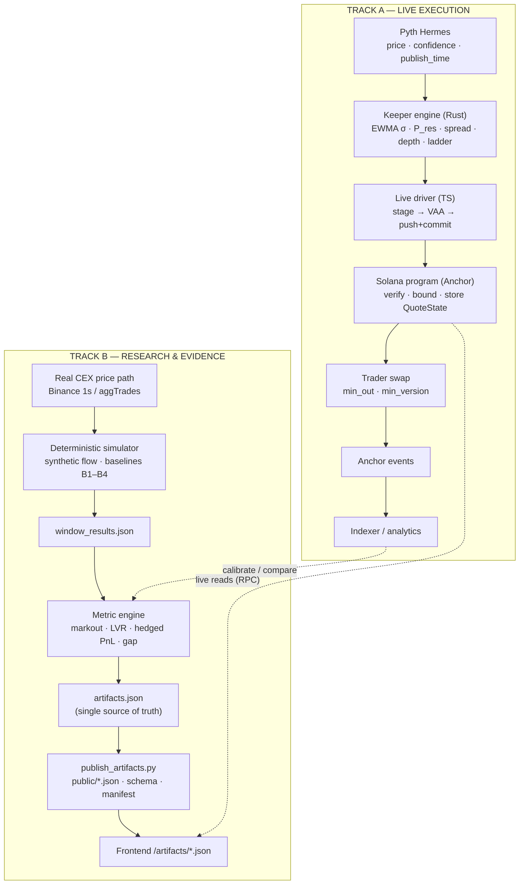
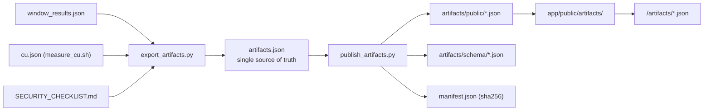
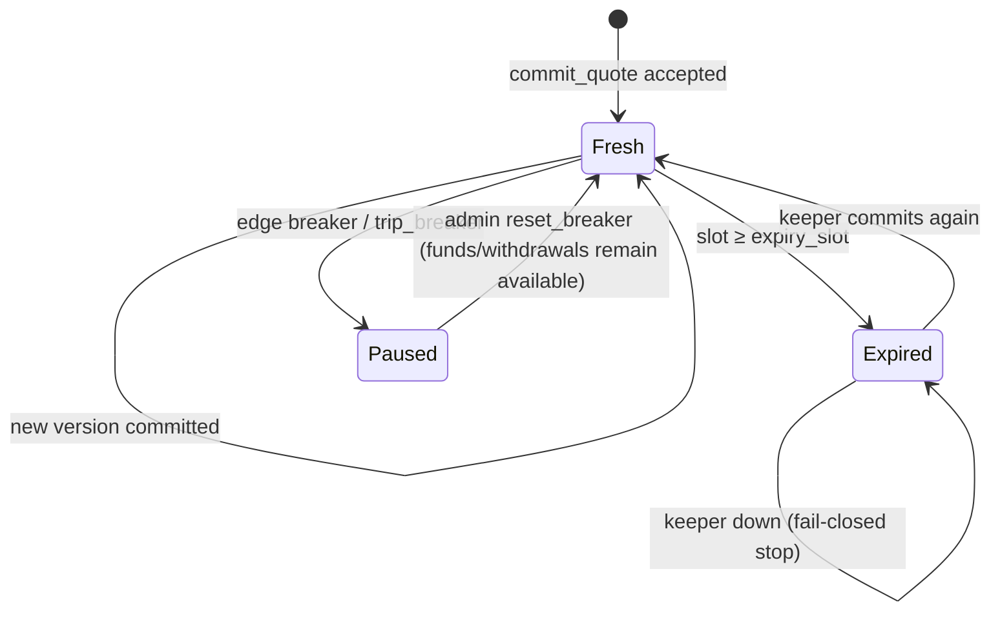

# ArbSwap Pipeline — From Market Data to On-Chain Execution to Published Evidence

> One repository, two deliberately separated pipelines:
> a **live, on-chain execution path** (Pyth → keeper → Solana program → swap) and a
> **deterministic research path** (real price data → simulator → metrics → versioned artifacts → dashboard).
> This document traces both, end to end, with the exact files and commands.

This is the operational companion to [`README.md`](../README.md) and
[`docs/ARCHITECTURE.md`](ARCHITECTURE.md). Every stage below names its inputs,
outputs, source path, and reproduction command.

---

## Table of contents

1. [Pipeline at a glance](#pipeline-at-a-glance)
2. [Design principles](#design-principles)
3. [Track A — Live execution (on-chain)](#track-a--live-execution-on-chain)
4. [Track B — Research & evidence (offline)](#track-b--research--evidence-offline)
5. [The artifact contract](#the-artifact-contract)
6. [Reproduce the whole pipeline](#reproduce-the-whole-pipeline)
7. [Integrity, freshness and documentation gates](#integrity-freshness-and-documentation-gates)
8. [Observability and failure handling](#observability-and-failure-handling)
9. [One tick, end to end](#one-tick-end-to-end)
10. [File map and interfaces](#file-map-and-interfaces)
11. [Judge demo script (5 minutes)](#judge-demo-script-5-minutes)
12. [Current status](#current-status)

---

## Pipeline at a glance



**The invariant across both tracks:** the same integer mathematics
(`vault/math/src/`, Q64.64) powers the keeper's quote, the program's execution,
the aggregator, and the Python reference. The pipeline never lets a floating
point or a recomputed formula drift into the money path.

---

## Design principles

| Principle | Consequence in the pipeline |
|---|---|
| **Execution is exact and shared** | `arb-math::walk_ladder` is used by keeper, program, aggregator; 997 golden vectors pin parity. |
| **The keeper proposes, the program disposes** | Every keeper value is re-validated on-chain (Pyth, anchor band, spread, capacity, slot). |
| **Fail closed** | Stale/expired/out-of-bound input → reject update or revert swap; never a degraded fill. |
| **One number, one source** | `simulation/data/results/artifacts.json` → `artifacts/public/*.json` + `manifest.json`; prose reads from it. |
| **Live ≠ modeled** | On-chain state is read from RPC; model outputs are served as versioned artifacts and labeled as such. |
| **Everything reproducible** | Deterministic seeds, pinned data hashes, one-command regeneration, CI gates. |

---

## Track A — Live execution (on-chain)

### Stage A1 — Oracle ingest

| | |
|---|---|
| **Input** | Pyth SOL/USD update from Hermes (`price`, `confidence`, `publish_time`) |
| **Code** | `scripts/devnet/keeper_live.ts`, `vault/keeper/src/` |
| **Output** | A verified price tick, normalized once to token units |
| **Command** | `cd scripts/devnet && ./demo_up.sh 3600` |

Two prices exist and must never be mixed:

```text
P_human  = quote per base            (USDC / SOL)
P_token  = P_human · 10^(d_quote − d_base)   (quote-atoms per base-atom)
```

The keeper normalizes with `normalize_price_q64`; the program independently
recomputes `normalize_pyth_price_q64` from the **verified** Pyth value and the
vault's own bound mints, and requires the submitted `oracle_price` to match.
Mint accounts are address-bound (`#[account(address = …)]`), so decimals cannot
be spoofed. Regression: `vault/program/tests/litesvm_oracle_scaling.rs`.

### Stage A2 — Strategy: build the quote

`vault/keeper/src/lib.rs::compute_quote`:

| Step | Formula | Purpose |
|---|---|---|
| Inventory | `q = (B·P − Q)/(B·P + Q)` | normalized exposure ∈ [−1, 1] |
| Reservation | `P_res = P·(1 − g·q)` | lean against inventory |
| Volatility | `v = λⁿv + (1−λⁿ)(r²/n)`, `σ = √v` | time-normalized EWMA + jump |
| Spread | `s = clamp(s_floor + a1σ + a2|q| + a3(c/P) + a4·age + a5·jump)` | price the risk |
| Direction | `ask_extra = e·max(0,move)`, `bid_extra = e·max(0,−move)` | widen the stale side |
| Depth | `depth_mult = min(σ-factor · confidence-factor · (1−jump), budget)` | shrink `V` as σ rises |
| Ladder | 6 levels, offsets `[2,5,10,20,40,80]` bps, weights Σ 10,000 | executable shape |

The output is a self-contained `QuoteUpdate` payload (anchor, spreads, 6 ask +
6 bid levels, oracle price/conf/publish time) encoded with the program's Borsh
layout.

### Stage A3 — Atomic commit (two-phase)

```mermaid
sequenceDiagram
  autonumber
  participant K as Keeper driver
  participant H as Pyth Hermes
  participant P as Solana program
  participant W as Wormhole / Pyth
  H-->>K: price · conf · publish_time
  K->>K: compute_quote (Rust engine, exact Borsh)
  K->>P: Tx A — stage_quote(update, nonce)
  Note right of P: writes PendingQuote only; live QuoteState untouched
  K->>W: Tx V — post EncodedVaa
  K->>P: Tx B — updatePriceFeed + commit_quote (ONE tx)
  P->>P: re-verify Pyth · bounds · capacity · slot
  P-->>K: QuoteState.version++
```

Why split: a quote-only rejection can never roll back a valid oracle write, and
the per-keeper nonce prevents replay and stale-pending commits. Commit sets
`expiry_slot = slot + expiry_slots`.

### Stage A4 — On-chain validation

`vault/program/src/lib.rs::commit_quote` / `::update_quote`, in order:

```text
status == ACTIVE
keeper authorized (allowlist if min_bond == 0; else bond PDA ≥ min_bond)
update_slot > stored && ≤ clock.slot && age ≤ max_update_slot_age
Pyth: owner · feed id · VerificationLevel::Full · freshness (seconds)
publish_time == submitted value; decoded price/conf equality
oracle_price == normalize_pyth_price_q64(verified pyth, base_dec, quote_dec)
anchor within max_anchor_step and the oracle deviation band
levels strictly inside the anchor band (outermost ≤ 500 bps)
min_spread_bps ≤ half_spread ≤ max_spread_bps; spread step ≤ max_spread_step_bps
Σ base/quote capacity ≤ utilization_max · available reserves (inverse-√ verified)
per-window one-sided flow cap
```

Pass → store `QuoteState` (`version++`, `expiry_slot`). Fail → revert; the old
quote simply ages out.

### Stage A5 — Swap execution

`vault/program/src/lib.rs::swap`:

```text
status ACTIVE · version ≥ min_version · slot < expiry_slot · 0 < amount ≤ max_quote_size
fee = ceil(amount_in · fee_bps / 10⁴) ; net = amount_in − fee
BuyBase → asks ; SellBase → bids
walk_ladder (exact constant-product segments) → out
out ≥ min_out  (SlippageExceeded)
window flow cap (FlowCapExceeded)
transfer tokens · split fee into insurance/keeper/protocol · emit SwapEvent
```

The ladder walk is the **same integer code** the keeper quoted with, so the
executed output equals the quoted output by construction (zero quote-vs-fill
gap). If the ladder cannot absorb the input: `CapacityExceeded`, never a partial
fill presented as complete.

### Stage A6 — Post-trade feedback

| Consumer | Reads | Effect |
|---|---|---|
| Keeper | new reserves | `q` shifts `P_res`; next tick republishes |
| Frontend | `Vault`, `QuoteState`, balances (RPC) | live TVL, ladder, status |
| Indexer | `SwapEvent` etc. | markouts, LVR, attribution |
| Breakpoint | realized edge | auto-pause if mis-anchored |

---

## Track B — Research & evidence (offline)

### Stage B1 — Input data

| | |
|---|---|
| **Source** | Binance SOL/USDT & SOL/USDC 1-second candles, USDC/USDT, 100 ms aggTrades |
| **Location** | `simulation/data/raw/` (gitignored) |
| **Manifest** | `simulation/data/README.md`, `docs/DATA_MANIFEST.md` |
| **Reality** | price path is **real**; order flow is **synthetic** (noise + informed) |

Gap-filling and USDC conversion are explicit and logged. Raw CSVs never enter
git; only scripts and hashes do.

### Stage B2 — Deterministic simulation

`simulation/sim/` runs an event-driven replay with three explicit clocks
(source / step / slot), a pre-registered study design (W1 calibrates; W2–W6 are
held out), and baselines:

- **B1** passive constant-product (1/5/30 bps tiers)
- **B2** fixed spread, **B3** no depth throttle, **B4** no honesty
- a **propAMM-like** venue for context only
- studies **S1–S5** (clock, slot length, oracle latency, seeds, regime mix)

Output: `simulation/data/results/window_results.json`.

### Stage B3 — Metrics

`simulation/analytics/metrics.py` computes, per window and venue:

| Metric | Definition |
|---|---|
| 2s markout | `10⁴·d·(m(t+2s)−p_exec)/p_exec` |
| Quiet half-spread | `10⁴·|p_exec−m(t)|/m(t)` on quiet fills |
| Hedged PnL | `Σ[V_{t+1}−V_t−B_t(P_{t+1}−P_t)]` |
| Quote-vs-fill gap | `10⁴·(out_quoted−out_executed)/out_quoted` |
| Passive LVR | `(σ²/8)·V·T` |

`simulation/analytics/lvr.py` builds the public, versioned `lvr_history.json`
from the same replay, with explicit `unavailable` fields for anything not
measured.

### Stage B4 — Bundle assembly (single source of truth)

`scripts/export_artifacts.py` aggregates every number that appears in prose or
docs into `simulation/data/results/artifacts.json`:

```text
meta        commit · date · flow_type · frozen-parameter hash · data hashes
calibration B1-vs-paper targets (W1)
e1_e4       W2–W6 per-venue metrics
held_out    full per-window regime + venue detail
studies     S1–S5
routed_world volume/fill share + markout
cost, cu    measured compute units + gas/priority
mutation    58/58 guard-mutation table (parsed from SECURITY_CHECKLIST.md)
test_counts measured Rust + Python totals
lvr         public LVR artifact summary
```

### Stage B5 — Publish the data contract

`scripts/publish_artifacts.py` writes:

```text
artifacts/public/*.json      the exact files the UI reads (no prose, no secrets)
artifacts/schema/*.json      one JSON Schema per file
artifacts/public/manifest.json  schema version · commit · generated date ·
                                flow type · frozen-param hash · sha256 per file
```

The deploy copies `artifacts/public/` → `app/public/artifacts/`, served at
`/artifacts/*.json`. The optional historical on-chain export is
`app/public/analytics/onchain.json` (read-only, historically labeled).

### Stage B6 — Frontend consumption

`app/src/data/backend.ts` fetches `/artifacts/*.json`; `AnalyticsPage` renders
model metrics, `LvrHistoryPanel`/`LvrSummaryCard` read
`/analytics/lvr_history.json`, and `OnchainAnalyticsPanel` reads the optional
`/analytics/onchain.json`. **Live pages (Overview/Swap/Vault/Risk) never read
artifacts** — they read Devnet RPC directly.

---

## The artifact contract



| Artifact | Consumer | Guarantee |
|---|---|---|
| `artifacts.json` | docs, tests, publish step | one number, one place |
| `artifacts/public/*.json` | frontend | schema-validated, no prose/secrets |
| `artifacts/schema/*.json` | CI / integrators | machine-checkable contract |
| `manifest.json` | `check_bundle_freshness.py` | per-file sha256 + recorded commit |
| `app/public/analytics/lvr_history.json` | Vault/Analytics | modeled LVR, explicit `null`s |

---

## Reproduce the whole pipeline

### Research track (no keys, local only)

```bash
# One-command P1 reproduction (needs raw data present)
bash scripts/p1_all.sh

# Or stage by stage
python -m simulation.sim.p1_calibrate
python -m simulation.sim.study all --workers 5
python -m simulation.sim.router
python -m simulation.analytics.lvr
python scripts/export_artifacts.py
python scripts/publish_artifacts.py
```

### Compute units (rebuilds the SBF program)

```bash
bash scripts/measure_cu.sh 5          # median of 5 samples → simulation/data/results/cu.json
python scripts/export_artifacts.py    # fold into the bundle
```

### Live track (signs Devnet transactions — test funds only)

```bash
cd scripts/devnet
set -a; . ../../.env; set +a          # PYTH_API_KEY / RPC / keypair path
export ARBSWAP_RPC_FALLBACKS=https://api.devnet.solana.com
./demo_up.sh 3600                     # supervised keeper (single-instance flock)

npx tsx demo_status.ts                # quote freshness / version
npx tsx keeper_inspect.ts             # quote layout, config, eligibility
```

### Frontend

```bash
cd app && npm install && npm run dev  # http://localhost:5173
```

---

## Integrity, freshness and documentation gates

| Gate | Command | What it enforces |
|---|---|---|
| Bundle freshness | `python scripts/check_bundle_freshness.py` | every file's sha256 matches `manifest.json`; recorded commit is an ancestor of HEAD; **no source changed after the bundle commit** |
| Docs consistency | `python scripts/check_docs_consistency.py` | prose CU/numbers match the bundle |
| Banned wording | `python scripts/banned_words.py` | no unsupported superlatives / unsafe claims |
| Secrets | `python scripts/secrets_scan.py` | no keys/seed phrases in tracked files |
| Frontend fixtures | `bash scripts/gen_frontend_fixtures.sh` | committed account fixtures match the program layout |
| Golden parity | `cargo test --workspace` | 997 vectors bit-exact across Rust ↔ Python |
| Schema | `python scripts/publish_artifacts.py` | every published file has a schema |

> If the freshness gate fails, the fix is to regenerate — never to hand-edit the
> manifest: `scripts/measure_cu.sh && python scripts/export_artifacts.py && python scripts/publish_artifacts.py`.

---

## Observability and failure handling



| Signal | Where | Meaning |
|---|---|---|
| `QuoteState.version` | on-chain | strictly advances only on a verified commit |
| `QuoteState.expiry_slot` | on-chain | after this, swaps revert (`QuoteExpired`) |
| `Vault.status` | on-chain | `ACTIVE` / `PAUSED` (breaker) |
| `VolatilityState` | on-chain | σ, jump flag, observation age |
| `logs/keeper_supervised.log` | operator | per-cycle Hermes/engine/stage/VAA/push timings |
| `demo_status.ts` | operator | FRESH vs EXPIRED, latency, keeper SOL |
| `manifest.json` | artifacts | provenance of every published number |

**Failure path:** bad/stale oracle → update rejected; keeper down → quote
expires → swaps revert; mis-anchored keeper → realized-edge breaker pauses;
volatility spike → kill-switch stops quoting. In every case the system stops
rather than filling at a price it cannot justify.

---

## One tick, end to end

```text
t0  Pyth Hermes returns price=150.02, conf=3 bps, publish_time=…
t1  Keeper: r = |P_t−P_{t−1}|/P_{t−1}; v = λⁿv + (1−λⁿ)r²/n; σ = √v
t2  Keeper: q from reserves; P_res = P(1−gq); s = clamp(floor + a1σ + …)
t3  Keeper: depth_mult from σ/confidence/jump; 6-level ladder built in arb-math
t4  Tx A stage_quote → PendingQuote; Tx V posts VAA; Tx B push+commit atomically
t5  Program: Pyth Full-verify, anchor/level/spread/capacity/slot checks pass
t6  QuoteState.version++ ; expiry_slot = slot + 120
t7  Trader swaps 1 SOL; walk_ladder → out ≥ min_out; fee = ceil(1 SOL·1 bp/10⁴)
t8  SwapEvent emitted; reserves update; keeper sees new q on next tick
t9  Offline: the same price path + a synthetic flow replay produce a markout;
    window_results.json → artifacts.json → /artifacts/held_out.json → dashboard
```

---

## File map and interfaces

```text
vault/math/src/            shared Q64.64 ladder / segment / share math
vault/keeper/src/          quote engine + offline pre-validation
vault/program/src/lib.rs   on-chain guards, custody, swap, breakers
vault/aggregator/src/      Jupiter-style quote adapter (same ladder)
scripts/devnet/            live driver, supervisor, status/inspect
simulation/reference/      independent Python reference + golden vectors
simulation/sim/            simulator, baselines, studies, router
simulation/analytics/      indexer, metrics, LVR artifact
scripts/export_artifacts.py  aggregate → artifacts.json
scripts/publish_artifacts.py → artifacts/public + schema + manifest
app/src/data/backend.ts    artifact fetch; app pages read RPC for live state
```

**Interfaces**

- keeper → program: `stage_quote` / `commit_quote` with an in-band Pyth account
  (one shared blockhash; atomic push+commit)
- program → indexer: Anchor events (`SwapEvent`, `QuoteCommitted`, …)
- analytics → frontend: versioned JSON under `artifacts/public/` and
  `app/public/analytics/`
- frontend → chain: RPC reads of `Vault`, `Config`, `QuoteState`,
  `VolatilityState`, token accounts

---

## Judge demo script (5 minutes)

1. **Overview** — live Devnet TVL, deployed params, quote status. Point out the
   program id and the verified Pyth feed.
2. **Swap** — watch the six-level ladder and the freshness countdown. The CTA is
   gated on a freshly committed quote; show the `build → simulate → preview →
   confirm` flow.
3. **Risk** — the on-chain volatility regime, spread floor and breaker state.
4. **Analytics** — the modeled results: positive 2s markout across held-out
   windows, LVR benchmark vs fees, routed-world table, and the LVR artifact
   (with `null` where a metric is not measured).
5. **Reproduce** — run `bash scripts/p1_all.sh` and
   `python scripts/check_bundle_freshness.py` live; show the manifest hashes and
   the 997-vector parity test.

The takeaway: **the same math that is modeled offline is the math enforced
on-chain, and every published number has a hash.**

---

## Current status

- **Track A:** deployed and running on Devnet; supervised keeper commits quotes
  with `COMMITTED_AND_VERIFIED` (version advances, quote stays fresh). Devnet
  only, test funds only.
- **Track B:** reproducible from pinned inputs; the bundle is schema-validated
  and manifest-hashed. Price path is real; flow is synthetic.
- **Not measured:** ArbSwap's own realized LVR (reported `null`), and live
  quote-vs-fill gap against competitors (proxy only). No independent audit yet.

Sources of truth: [`README.md`](../README.md), [`docs/CLAIMS.md`](CLAIMS.md),
[`docs/ARCHITECTURE.md`](ARCHITECTURE.md), [`docs/FORMULA.md`](FORMULA.md),
[`MATH.md`](../MATH.md).
